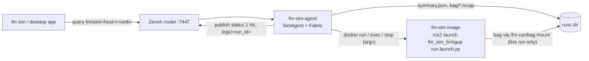

# fm-sim-agent

The host-side agent that makes a machine a First Motive sim host. It serves the
run control verbs under `fm/sim/<host>/` over Zenoh, starts each run as a
container of the fm-sim image, and files a summary of every run on the host.

## Why

Simulation runs on more than one kind of host: a Mac under OrbStack, fm-ws-01,
a cloud box. The `fm sim` CLI and the desktop app should drive all of them the
same way, without SSH and without knowing where Docker lives. The agent gives
every sim host the same verb set on the fleet's Zenoh fabric, the way
fm-robot-agent does for robots, so a client needs only a host name.

It is its own uv project rather than a colcon package (`COLCON_IGNORE` keeps
colcon out). It runs beside Docker, outside any ROS environment, and reaches the
ROS stack only through the image.

## How



| Verb | Kind | Request | Reply |
|---|---|---|---|
| `status` | queryable, and published at 1 Hz | none | `{"ok": true, host, state, run_id, spec, since, version, error?}` |
| `catalog` | queryable | none | `{"ok": true, "catalog": {...}}` |
| `up` | queryable | RunSpec | `{"ok": true, "run_id"}` |
| `down` | queryable | `{"run_id"?}` | `{"ok": true, "summary": RunSummary}` |
| `reset` | queryable | `{"seed": int}` | `{"ok": true}` |
| `runs` | queryable | `{"limit"?: int}` | `{"ok": true, "runs": [RunSummary]}`, newest first |
| `description` | queryable | none | `{"ok": true, run_id, urdf}`, the active run's `/robot_description` |
| `asset` | queryable | `{"uri": "package://…"}` | the mesh's raw bytes; only a `<visual>` mesh the run's description names |
| `logs` | published on `fm/sim/<host>/logs/<run_id>` | none | one `{"t", "level", "node", "msg"}` per line |

The shapes are the ones in the simulation contracts (§3). A refusal is a Zenoh
error reply whose body is `{"ok": false, "error": {"code", "message"}}`, the way
fm-robot-agent sends its refusals. Codes: `invalid_request`, `invalid_spec`,
`unknown_entry`, `unavailable_entry`, `catalog_unavailable`, `busy`,
`run_exists`, `start_failed`, `not_running`, `run_mismatch`,
`reset_unavailable`, `reset_failed`, `insufficient_space`, `unknown_verb`,
`internal_error`.

A message is a short reason meant for the caller. What a container call
printed, such as Docker's stderr or a traceback, goes to the agent's own log
(the journal under systemd) and never onto the fabric. `busy` also answers a
query that arrives while the agent already holds as many as it will take: eight
in hand for most verbs, two for `down`, which has a worker of its own so that
stopping a run never waits behind a catalog fetch.

In a log record, `t` is Unix seconds (the ROS stamp when the line carries one),
and `level` is one of `debug`, `info`, `warn`, `error` or `fatal`. A line that is
not a ROS log line is forwarded as `info` from its launch process. A message is
cut at 4096 bytes. At most 200 records a second are published per run; past
that, lines are dropped and one `warn` record from `fm_sim_agent` says how many.

### A Run

```
idle ─up─▶ starting ─broadcasters active─▶ running ─down─▶ stopping ─▶ idle
              └── start fails / not ready / container exits / log stream fails ──▶ error
```

- `up` validates the RunSpec strictly. Each of `backend`, `robot`, `scenario`
  and `controller` must match `^[a-z][a-z0-9_]*$` and name an available entry
  in the image's catalog. `seed` is an integer from 0 to 2³²−1 and `record` is
  a boolean. Any other key, `params` included, is refused: v1 takes no
  caller-supplied launch arguments.
- `up` refuses with `busy` while a run is active. Otherwise it runs
  `docker run --detach <image> /ros_entrypoint.sh ros2 launch fm_sim_bringup
  run.launch.py backend:=… robot:=… scenario:=… controller:=… use_sim:=true`
  and answers with the run id.
- The run stays `starting` until controller_manager's `list_controllers`
  reports every broadcaster in the robot's catalog entry
  (`controller_roles.broadcasters`) as active. A robot entry without that list
  is refused at `up`. Readiness is polled once a second for up to 180 s.
- Once ready, if `ros2 service list` shows `/sim/reset`, it is called with the
  spec's seed. If the graph has no `/sim/reset`, the seed cannot be applied:
  the summary's `metrics.seed_applied` is then false, unless the seed is 0,
  the scenario's own default. With `record` on, `ros2 bag record -s mcap -a`
  then starts in the container. It starts a new MCAP file every 600 s or
  4 GiB, whichever comes first.
- `down` reads the latched `/sim/outcome`, stops the recorder with SIGINT so
  the MCAP is closed properly, stops and removes the container, and writes
  the summary. The outcome is kept only when its scenario and seed are the
  run's: the spec's seed, or the last `reset` that took. A run stopped after a
  reset but before the new episode ended reports a null outcome, not the
  previous episode's.
- `up` is refused with `insufficient_space` when the runs directory has less
  than 10 GiB free. A run still up after 2 hours is brought down by the agent,
  and its summary's `metrics.max_duration_reached` is true.
- A run is finalised the same way when it fails to start, or is not ready in
  time, or its container exits on its own, or its log stream fails. Without the
  log stream the agent cannot see the container exit. The agent reports
  `error` and accepts the next `up`. Every failure in `docker run`, a timeout
  included, also stops the container, since it may have been created anyway.
  `docker run` uses `--pull=never`, so a missing image fails at once instead of
  pulling under the start timeout.
- `down` is accepted while a run is `starting`, even before `docker run` has
  returned. In that case the agent stops the container once `docker run`
  returns and starts nothing for the run. A step of the startup that a down has
  overtaken, such as seeding or recording, is skipped.
- `catalog` runs `ros2 run fm_sim_bringup catalog --json` in a throwaway
  container named `fm-sim-catalog-<image id>` and labelled as the agent's. A
  fetch that fails or times out removes it. The result is cached against the image id, so it is fetched
  again only when the image changes. Concurrent queries share one fetch, and
  a failed fetch is not retried for 10 s.

Every container call is an argv list. Nothing a caller sends reaches a shell.

### On Disk

```
<runs_dir>/<run_id>/summary.json   written at up (ended_at null), rewritten at the end
<runs_dir>/<run_id>/bag/           mounted into the run's container at /fm-run/bag
<runs_dir>/<run_id>/bag/recording/ the MCAP files, only when record is true
```

A summary's `mcap` names the first MCAP file, relative to the runs directory
(`<run_id>/bag/recording/recording_0.mcap`), so it names the same file wherever
the directory is read from. `metrics.mcap_files` and `metrics.mcap_bytes` count
every file the run wrote. The container writes into `bag/`, so the agent follows
no symlink there. It also refuses a symlinked run directory or summary, both
when reading and when writing. `runs` lists directories newest first by name, which starts with
the UTC start time, and reads only as many summaries as it returns. A file that
is oversized, not JSON, missing a RunSummary key or filed under another run id
is skipped.

`<runs_dir>` defaults to `$XDG_STATE_HOME/fm-sim/runs`
(`~/.local/state/fm-sim/runs`). Only the run's `bag/` directory is mounted into
its container, so a run cannot read or overwrite another run's files, nor its
own summary.

At start-up the agent removes any container labelled `fm.sim.agent=<host>`, and
closes any summary still open. Both are left over from an agent that died
mid-run.

## Trust Boundary

The agent does not authenticate callers. It trusts the tailnet ACL on the fleet
router's port 7447, as fm-robot-agent does: **any tailnet node that can reach
:7447 can call every verb**, which includes starting and stopping runs on this
host. Per-caller authentication is a fleet-wide follow-up, not something this
agent adds alone.

The agent's account runs `docker`, and membership of the `docker` group is
root-equivalent on the host. The agent therefore keeps what a caller can choose
narrow, and confines what it starts:

- A caller picks four catalog names, a seed and a record flag. Nothing else a
  caller sends reaches a command line, and no command goes through a shell.
- Every container runs as the agent's own uid and gid, with
  `--cap-drop ALL --security-opt no-new-privileges`, a process ceiling
  (`--pids-limit`, 4096 by default) and a memory ceiling (`--memory`, 16 GiB by
  default).
- Host networking, host IPC, GPUs and extra `docker run` arguments are the
  operator's flags on the agent. No query can turn them on.
- Runs are host-local on DDS: every container gets
  `ROS_AUTOMATIC_DISCOVERY_RANGE=LOCALHOST`, so on a LAN shared with real
  robots no sim topic reaches a robot's graph. Only the zenoh bridge on the
  host carries anything off it. `--dds-range` is the only way to change this;
  the host's own environment is not passed through for it.
- A run sees only its own `bag/` directory under the runs directory.
- A run's length and the disk it needs are bounded: a maximum run duration,
  MCAP file splitting, and a free-space check at `up`.

## Run It

```bash
uv sync
uv run fm-sim-agent                    # host name from machine.json, router from /etc/fm-comms.env
uv run fm-sim-agent --host local --no-host-network --image fm-sim:jazzy
```

| Flag | Default | Meaning |
|---|---|---|
| `--host NAME` | the card's `name` | key segment, `-` becomes `_` |
| `--label NAME` | the host segment | `fm.sim.agent` label on its containers; `up` is `busy` while another process's run is up under it |
| `--image REF` | `$FM_SIM_IMAGE`, else `ghcr.io/first-motive/fm-sim:jazzy` | image runs use; pin a digest on a host |
| `--runs-dir DIR` | `$XDG_STATE_HOME/fm-sim/runs` | where summaries and bags go |
| `--gpus` | off | `--gpus all` for Isaac |
| `--no-host-network` | host network on | macOS, where the container cannot share the host's network |
| `--docker-arg ARG` | none | extra `docker run` argument, repeatable |
| `--dds-range R` | `LOCALHOST` | `ROS_AUTOMATIC_DISCOVERY_RANGE` for every container: `LOCALHOST`, `SUBNET`, `OFF` or `SYSTEM_DEFAULT` |
| `--pids-limit N` | 4096 | process ceiling per run |
| `--memory SIZE` | `16g` | memory ceiling per run, as `docker run --memory` takes it |
| `--max-run-minutes M` | 120 | bring a run down after this long |
| `--min-free-gb G` | 10 | refuse `up` below this much free disk under the runs dir |
| `--bag-split-seconds S` | 600 | start a new MCAP file after this long |
| `--bag-split-mb MB` | 4096 | start a new MCAP file past this size |

The host name comes from the identity card that fm-robot-agent also reads:
`$FM_MACHINE_FILE`, else `~/.config/fm/machine.json` on macOS and
`/etc/fm/machine.json` elsewhere. The router comes from `FM_ROUTER_ENDPOINT`,
read from the environment or from `/etc/fm-comms.env`. Runs inherit
`ROS_DOMAIN_ID`, `RMW_IMPLEMENTATION` (default `rmw_cyclonedds_cpp`),
`FM_COMMS_PROFILE` and, through `FM_CYCLONEDDS_XML`, the
host's Cyclone profile. These are fm-docker's compose base passthroughs, less
`ROS_LOCALHOST_ONLY`: discovery range is set by `--dds-range` instead.

## The fm sim CLI

`fm sim` runs `scripts/run/sim.sh` at the repo root, which runs this project's
`fm-sim` entry point (`fm_sim_agent.client`). Every verb takes `--host`: a
machine name (`fm-ws-01`, sent as `fm_ws_01`) or `local`.

```bash
fm sim catalog --host fm-ws-01                  # what the host can run
fm sim status  --host fm-ws-01                  # state and active run
fm sim up      --host fm-ws-01 [--backend B] [--robot R] [--scenario S] [--controller C] [--seed N] [--record]
fm sim logs    --host fm-ws-01 [--run-id ID]    # follow the run's log records; Ctrl-C stops
fm sim down    --host fm-ws-01 [--run-id ID]    # stop the run; prints its outcome
fm sim runs    --host fm-ws-01 [--limit N]      # summaries, newest first
fm sim trial   --host fm-ws-01 (--seeds 0..19 | --count 20 [--seed-start 0]) [--run-timeout S] [--report PATH]
```

The spec flags default to `mujoco`, `openarm`, `empty`, `idle`, seed 0, no
recording. `--json` prints the raw reply. Exit codes: 0 success, 1 the host
refused, 2 usage, 3 no router endpoint or no answer, 130 interrupted.

A remote host is one Zenoh query per verb through the fleet router, which is
read from `FM_ROUTER_ENDPOINT` or `/etc/fm-comms.env` as for the agent. `up`
returns once the run is started; the host's agent keeps it.

### Trials

`trial` runs one spec once per seed, in order, since a host runs one run at a
time. `--seeds` takes `0..19` (inclusive), `0,3,7` or a mix; `--count N
--seed-start S` is the same as `S..S+N-1`. A seed named twice is refused. Each
run is brought up, then brought down when its outcome is in, when it ends on
its own, or after `--run-timeout` seconds (300 by default, start-up included).
`down` reads the latched `/sim/outcome`, and its RunSummary is the score.

A remote agent shows the outcome only at `down`, so on a remote host every run
is given its whole `--run-timeout` unless it ends on its own. In local mode the
CLI asks the run's container for `/sim/outcome` while the run is up, so a run
ends as soon as it is scored.

Each run prints one row as it finishes. The trial then prints a table and the
success rate, and writes a JSON report to `--report`, by default
`$XDG_STATE_HOME/fm-sim/trials/<UTC stamp>-<backend>-<robot>-<scenario>-<controller>.json`.
The report holds the spec, the seeds, one row per run (`seed`, `run_id`,
`success`, `reason`, `elapsed_s`, `wall_s`, `seed_applied`), and `attempted`,
`successes`, `unscored` and `success_rate`. A run with no outcome counts as a
failure in `success_rate`. A run whose `down` was refused and whose summary
cannot be found has the reason `down refused: <code>`. A refused `up` (`busy` included) or a host that
stops answering ends the trial early, and Ctrl-C ends it after the current run
is brought down. Either way the report is still written, with `complete` false.

### Local Mode

With no managed agent running (see [This Mac](#this-mac)), `--host local`
builds the same `SimAgent` and `DockerRunner` the service does, in this
process, under the host name `local`, against this machine's Docker
(OrbStack on a Mac). No router, Zenoh session or systemd unit is involved.
Runs do not share the host's network. The image is `--image`, else
`$FM_SIM_IMAGE`, else `ghcr.io/first-motive/fm-sim:jazzy`, and it must already
be on the machine, since runs use `--pull=never`. Summaries go under
`--runs-dir`, by default the agent's own runs directory.

The agent lives only as long as the command, which changes three verbs:

- `up` stays in the foreground and prints the run's log lines. It brings the
  run down on Ctrl-C, once its outcome is in, or after `--duration` seconds.
  Whichever way the command exits short of being killed, Ctrl-C mid-start
  included, it brings its run down first.
- `up` and `trial` refuse with `busy` while another process's run container is
  up under the `local` label. The check and the start are not atomic: two
  commands started in the same moment can both pass it.
- `down` with no run in this process removes every container under the `local`
  label and closes the summaries left open, as the agent does when it starts.
  It prints the summary of the run it found. With `--run-id`, a different run
  is refused with `run_mismatch` and nothing is removed.
- `--duration` is checked between polls, and a poll can wait up to 5 s on the
  container's `/sim/outcome`, so a run can outlast its duration by that much.

`status` and `logs` find another process's run through the same label. `logs`
then reads the container's own output with `docker logs --follow`.

### Cloud Host

`host` starts, stops or reads the AWS sim host stack
([`infra/aws/sim`](../infra/aws/sim/README.md)) through the operator's `aws`
CLI, run as argv with no shell. It needs no router.

```bash
fm sim host status aws [--stack NAME] [--region R] [--profile P] [--json]
fm sim host start  aws [--stack NAME] [--region R] [--profile P] [--json]
fm sim host stop   aws [--stack NAME] [--region R] [--profile P] [--json]
```

The stack is `--stack`, else `$FM_SIM_CLOUD_STACK`; one is required. The
region is `--region`, else `$FM_SIM_CLOUD_REGION`, else the `aws` default, and
the profile is `--profile`, else the `aws` default. Each verb first reads the
stack's outputs with `cloudformation describe-stacks`, which the stack's
operator and viewer policies grant. A role without that grant (one written
before it, or scoped tighter) is denied the call, and the CLI then uses the
names the stack contract fixes: `<stack>-controller` and `/<stack>/status`.

- `status` reads the `/<stack>/status` parameter. It never invokes the
  controller, so the viewer policy is enough.
- `start` and `stop` invoke the controller with exactly `{"action": "start"}`
  or `{"action": "stop"}`. A `TooManyRequestsException` is retried up to three
  times, after 1, 2 and 4 s. Nothing calls the Auto Scaling group.

Every reply is checked against the stack's schema before it is printed. An
unknown state, budget reason or refusal code, or a budget amount that is not a
finite number, is `invalid_reply`. Each field prints with control characters
removed. The lines show the state, desired capacity, each instance's launch
time and `terminate_after`, and the budget's actual spend, limit and gate.
`running` means the instance is in service, not that its agent answers; `fm sim
status --host <HostName>` says that.

`--json` prints the checked reply with a `stack` object (`name`, `region`,
`host_name`): `{"ok": true, "status"}`, the controller's refusal, or, when AWS
could not be asked, `{"ok": false, "error": {"code", "message"}}`. Exit codes:
0 success, 1 the controller refused (`budget_blocked`, `budget_unavailable`,
`controller_error`, ...), 2 usage, 3 AWS could not be asked or answered outside
the schema (`aws_unavailable`, `aws_timeout`, `stack_not_found`,
`invalid_reply`, or the `aws` error code).

### This Mac

`host … local` makes this machine a sim host the desktop app can drive: it
checks the container runtime, pulls the pinned image, and runs this machine's
agent as a managed background process. The app runs these same commands and
reads their `--json`; it never runs Docker itself.

`local` is the CLI's word for this machine; it is never a name on the router,
where two Macs would collide. The agent serves under this machine's name: the
`name` on its identity card (`$FM_MACHINE_FILE`, else
`~/.config/fm/machine.json` on macOS), else the hostname's first label in
lower case, with `-` becoming `_` (`nish-mbp` → `nish_mbp`). A card that is
there but names no valid segment is a usage error, not a fallback to the
hostname.

```bash
fm sim host status local [--json]   # runtime, image and agent; read-only
fm sim host pull   local [--json]   # pull the pinned image, streaming progress
fm sim host start  local [--json]   # start the agent detached; a no-op if it runs
fm sim host stop   local [--json]   # SIGTERM, then SIGKILL after 60 s
```

- **Runtime.** `docker context show` and `docker info` say whether a runtime
  answers and which one: `orbstack` when the context or the daemon's
  operating system names OrbStack, else `docker` (Docker Desktop and the
  rest), or none when there is no `docker` on `PATH`.
- **Image.** The ref is `$FM_SIM_IMAGE`, else `ghcr.io/first-motive/fm-sim:jazzy`,
  the one `--host local` and the service use. Its pin is
  `DEFAULT_IMAGE_DIGEST` in `fm_sim_agent/service.py`, the one place it
  lives, or `$FM_SIM_IMAGE_DIGEST` to try another. A ref other than the
  default has no pin unless that variable names one. `local_digest` is the
  image's registry digest for that repository, or null for an image built on
  this machine. `update_available` is true only when the image is here and
  its digest is not the pin; with no pin it is always false, and `status`
  and `start` print a warning on stderr (never on stdout, which `--json`
  keeps to the reply). A malformed ref or pin is refused wherever it is read:
  here, by the in-process `--host local` verbs, and by the service.
- **Pull.** With a pin, `docker pull <repo>@<pin>`, then `docker tag` back to
  the ref, so `--pull=never` runs find it; a pull that does not land on the
  pin is `digest_mismatch`. Without one, `docker pull <ref>`. Each output line
  becomes a progress event. The CLI has no terminal, so Docker prints a line
  per layer change rather than byte counts; `current` and `total`, in bytes,
  appear only on a line that carries `<n><unit>/<n><unit>` (`12.5MB/45MB`,
  `512B/1.5kB`; decimal units, as Docker prints them).
- **Start.** A no-op when the managed agent already runs, checked first.
  Otherwise refused, in this order, with `runtime_unavailable`,
  `image_missing`, `already_running_elsewhere` (another sim agent for this
  machine that this command did not start: `<python> -m
  fm_sim_agent.service` or the `fm-sim-agent` entry point, run with `--host`
  as this machine's name or `local`, or with no `--host`; or a run container up under
  the `local` label, such as an `fm sim up --host local` in a terminal) or
  `router_unavailable` (no `FM_ROUTER_ENDPOINT`). It then runs
  `python -m fm_sim_agent.service --host <this machine> --label local
  --no-host-network --image <ref>` in a session and process group of its own,
  so it outlives a caller that kills the command's process group once it
  returns, with stdout and stderr appended to the log, and
  watches it for 3 s: an agent that exits in that time, as one does when it
  cannot reach the router, is `start_failed` with its last log line.
- **The agent** is the service a sim host runs, so it serves
  `fm/sim/<this machine>/*` with the same verbs, off the host network, with DDS discovery at
  `LOCALHOST`. It is a Zenoh client of the fleet router, as the app is: the
  app finds it there, and finds nothing if this machine has no router
  endpoint.
- **Stop.** SIGTERM, on which the agent brings its active run down through
  its own `down` and exits. One still up after 60 s is killed with its
  session, and the run containers that were up under the `local` label when
  `stop` began (with the agent running, only its own) are removed by name,
  since its `down` never finished. A run another process starts during the
  grace is left alone. Each signal is sent only after `ps` confirms the pid is
  still the agent. With no agent running, `stop` only clears a stale pidfile.

The pidfile and log live in `$XDG_STATE_HOME/fm-sim/local-agent/` (by default
`~/.local/state/fm-sim/local-agent/`), a `0700` directory: `agent.pid` holds
the pid, start time, argv and served host name, and `agent.log` is moved to `agent.log.1` at a
`start` once it passes 10 MiB. `status` counts the agent as running only when
`ps` shows that pid alive with the argv the pidfile names, so a pid reused by
another process reads as not running and `stop` never signals it; so does a
pidfile whose host is not a key segment. A lock in that directory is held only
to read the pidfile and spawn or signal, never across a Docker probe, the
start-up watch or the stop grace, so a slow `stop` never stalls a `start`
(which finds the agent still up and does nothing). Two starts in the same
moment spawn one agent: the second finds the first's under the lock.

`--json` prints one JSON object per line. The last line is the reply:
`{"ok": true, "status": LocalStatus}`, or `{"ok": false, "error": {"code",
"message"}, "status": LocalStatus}`. Before it, `pull` prints one
`{"event": "progress", "layer"?, "current"?, "total"?, "message"}` per
update. Every string is cleaned of control and bidi characters. Exit codes:
0 success, 1 refused (`runtime_unavailable`, `image_missing`,
`already_running_elsewhere`, `router_unavailable`, `start_failed`,
`pull_failed`, `digest_mismatch`, `stop_failed`, `state_unavailable`), 2 usage
(`--stack`, `--region` or `--profile`, a malformed `$FM_SIM_IMAGE` or pin,
or a machine card that names no key segment), 130 interrupted, which still
ends with a reply line whose code is `interrupted`.

```
LocalStatus = {schema_version: 1,
  runtime: {available, name: "orbstack"|"docker"|null, message},
  image:   {ref, pinned_digest|null, present, local_digest|null, update_available},
  agent:   {running, pid|null, since|null, host: <this machine's segment>, log_path}}
```

While the managed agent runs, every `fm sim … --host local` verb goes to it
over the router under this machine's name, as to any remote host; `--image`,
`--runs-dir` and `--duration` are then a usage error. With no managed agent,
`--host local` runs the agent in-process as before. Both put their run
containers under the `local` label, and every agent's `up` is refused `busy`
while a run under its label that it did not start is up, so the managed agent
and an in-process run each refuse the other. A listing that fails lets `up` go
ahead, and the check and the start are not atomic. An agent whose `--label`
differs from its host name (the managed one) also removes nothing at start-up
while a run is up under that label, since another process may hold it; a run a
dead agent left there is cleared by `fm sim down --host local` once no managed
agent runs.

### As A Service

`systemd/fm-sim-agent.service.in` is a template in fm-robot-agent's form.
`@USER@`, `@WORKDIR@` (this directory) and `@UV@` are filled in by the installer
(fm-setup's sim workload). The account must be able to run `docker`.

## Test

```bash
uv sync --extra dev
uv run pytest
uv run ruff check src tests
```

The suite drives every verb through `SimAgent.answer` with a fake runner, and
again over a pair of in-process Zenoh peer sessions on 127.0.0.1. The CLI is
driven the same two ways: against that peer pair, and in local mode against
the in-process agent with the fake runner. It runs
`DockerRunner` against a stand-in `docker` executable that records its argv, and
`fm sim host` against a stand-in `aws` on `PATH`. `fm sim host … local` runs
against a stand-in `docker` on `PATH` and spawns, signals and identifies a
stand-in agent process through the real `ps`. No router, Docker daemon,
image or AWS account is needed.
