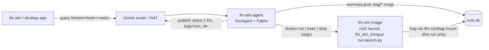

# fm-sim-agent

The host-side agent that makes a machine a First Motive sim host. It serves the
run control verbs under `fm/sim/<host>/` over Zenoh, starts each run as a
container of the fm-sim image, and files a summary of every run on the host.

## Why

Simulation runs on more than one kind of host: a Mac under OrbStack, fm-ws-01,
a cloud box. The `fm sim` CLI and the desktop app should drive all of them the
same way, without SSH and without knowing where Docker lives. The agent gives
every sim host the same verb set on the fleet's Zenoh fabric, the way
fm-robot-agent does for robots, so a client needs only a host name.

It is its own uv project rather than a colcon package (`COLCON_IGNORE` keeps
colcon out). It runs beside Docker, outside any ROS environment, and reaches the
ROS stack only through the image.

## How



| Verb | Kind | Request | Reply |
|---|---|---|---|
| `status` | queryable, and published at 1 Hz | none | `{"ok": true, host, state, run_id, spec, since, version, error?}` |
| `catalog` | queryable | none | `{"ok": true, "catalog": {...}}` |
| `up` | queryable | RunSpec | `{"ok": true, "run_id"}` |
| `down` | queryable | `{"run_id"?}` | `{"ok": true, "summary": RunSummary}` |
| `reset` | queryable | `{"seed": int}` | `{"ok": true}` |
| `runs` | queryable | `{"limit"?: int}` | `{"ok": true, "runs": [RunSummary]}`, newest first |
| `logs` | published on `fm/sim/<host>/logs/<run_id>` | none | one `{"t", "level", "node", "msg"}` per line |

The shapes are the ones in the simulation contracts (§3). A refusal is a Zenoh
error reply whose body is `{"ok": false, "error": {"code", "message"}}`, the way
fm-robot-agent sends its refusals. Codes: `invalid_request`, `invalid_spec`,
`unknown_entry`, `unavailable_entry`, `catalog_unavailable`, `busy`,
`run_exists`, `start_failed`, `not_running`, `run_mismatch`,
`reset_unavailable`, `reset_failed`, `insufficient_space`, `unknown_verb`,
`internal_error`.

A message is a short reason meant for the caller. What a container call
printed, such as Docker's stderr or a traceback, goes to the agent's own log
(the journal under systemd) and never onto the fabric. `busy` also answers a
query that arrives while the agent already holds as many as it will take: eight
in hand for most verbs, two for `down`, which has a worker of its own so that
stopping a run never waits behind a catalog fetch.

In a log record, `t` is Unix seconds (the ROS stamp when the line carries one),
and `level` is one of `debug`, `info`, `warn`, `error` or `fatal`. A line that is
not a ROS log line is forwarded as `info` from its launch process. A message is
cut at 4096 bytes. At most 200 records a second are published per run; past
that, lines are dropped and one `warn` record from `fm_sim_agent` says how many.

### A Run

```
idle ─up─▶ starting ─broadcasters active─▶ running ─down─▶ stopping ─▶ idle
              └── start fails / not ready / container exits / log stream fails ──▶ error
```

- `up` validates the RunSpec strictly. Each of `backend`, `robot`, `scenario`
  and `controller` must match `^[a-z][a-z0-9_]*$` and name an available entry
  in the image's catalog. `seed` is an integer from 0 to 2³²−1 and `record` is
  a boolean. Any other key, `params` included, is refused: v1 takes no
  caller-supplied launch arguments.
- `up` refuses with `busy` while a run is active. Otherwise it runs
  `docker run --detach <image> /ros_entrypoint.sh ros2 launch fm_sim_bringup
  run.launch.py backend:=… robot:=… scenario:=… controller:=… use_sim:=true`
  and answers with the run id.
- The run stays `starting` until controller_manager's `list_controllers`
  reports every broadcaster in the robot's catalog entry
  (`controller_roles.broadcasters`) as active. A robot entry without that list
  is refused at `up`. Readiness is polled once a second for up to 180 s.
- Once ready, if `ros2 service list` shows `/sim/reset`, it is called with the
  spec's seed. If the graph has no `/sim/reset`, the seed cannot be applied:
  the summary's `metrics.seed_applied` is then false, unless the seed is 0,
  the scenario's own default. With `record` on, `ros2 bag record -s mcap -a`
  then starts in the container. It starts a new MCAP file every 600 s or
  4 GiB, whichever comes first.
- `down` reads the latched `/sim/outcome`, stops the recorder with SIGINT so
  the MCAP is closed properly, stops and removes the container, and writes
  the summary.
- `up` is refused with `insufficient_space` when the runs directory has less
  than 10 GiB free. A run still up after 2 hours is brought down by the agent,
  and its summary's `metrics.max_duration_reached` is true.
- A run is finalised the same way when it fails to start, or is not ready in
  time, or its container exits on its own, or its log stream fails. Without the
  log stream the agent cannot see the container exit. The agent reports
  `error` and accepts the next `up`. Every failure in `docker run`, a timeout
  included, also stops the container, since it may have been created anyway.
  `docker run` uses `--pull=never`, so a missing image fails at once instead of
  pulling under the start timeout.
- `down` is accepted while a run is `starting`, even before `docker run` has
  returned. In that case the agent stops the container once `docker run`
  returns and starts nothing for the run. A step of the startup that a down has
  overtaken, such as seeding or recording, is skipped.
- `catalog` runs `ros2 run fm_sim_bringup catalog --json` in a throwaway
  container named `fm-sim-catalog-<image id>` and labelled as the agent's. A
  fetch that fails or times out removes it. The result is cached against the image id, so it is fetched
  again only when the image changes. Concurrent queries share one fetch, and
  a failed fetch is not retried for 10 s.

Every container call is an argv list. Nothing a caller sends reaches a shell.

### On Disk

```
<runs_dir>/<run_id>/summary.json   written at up (ended_at null), rewritten at the end
<runs_dir>/<run_id>/bag/           mounted into the run's container at /fm-run/bag
<runs_dir>/<run_id>/bag/recording/ the MCAP files, only when record is true
```

A summary's `mcap` names the first MCAP file, relative to the runs directory
(`<run_id>/bag/recording/recording_0.mcap`), so it names the same file wherever
the directory is read from. `metrics.mcap_files` and `metrics.mcap_bytes` count
every file the run wrote. The container writes into `bag/`, so the agent follows
no symlink there. It also refuses a symlinked run directory or summary, both
when reading and when writing. `runs` lists directories newest first by name, which starts with
the UTC start time, and reads only as many summaries as it returns. A file that
is oversized, not JSON, missing a RunSummary key or filed under another run id
is skipped.

`<runs_dir>` defaults to `$XDG_STATE_HOME/fm-sim/runs`
(`~/.local/state/fm-sim/runs`). Only the run's `bag/` directory is mounted into
its container, so a run cannot read or overwrite another run's files, nor its
own summary.

At start-up the agent removes any container labelled `fm.sim.agent=<host>`, and
closes any summary still open. Both are left over from an agent that died
mid-run.

## Trust Boundary

The agent does not authenticate callers. It trusts the tailnet ACL on the fleet
router's port 7447, as fm-robot-agent does: **any tailnet node that can reach
:7447 can call every verb**, which includes starting and stopping runs on this
host. Per-caller authentication is a fleet-wide follow-up, not something this
agent adds alone.

The agent's account runs `docker`, and membership of the `docker` group is
root-equivalent on the host. The agent therefore keeps what a caller can choose
narrow, and confines what it starts:

- A caller picks four catalog names, a seed and a record flag. Nothing else a
  caller sends reaches a command line, and no command goes through a shell.
- Every container runs as the agent's own uid and gid, with
  `--cap-drop ALL --security-opt no-new-privileges`, a process ceiling
  (`--pids-limit`, 4096 by default) and a memory ceiling (`--memory`, 16 GiB by
  default).
- Host networking, host IPC, GPUs and extra `docker run` arguments are the
  operator's flags on the agent. No query can turn them on.
- Runs are host-local on DDS: every container gets
  `ROS_AUTOMATIC_DISCOVERY_RANGE=LOCALHOST`, so on a LAN shared with real
  robots no sim topic reaches a robot's graph. Only the zenoh bridge on the
  host carries anything off it. `--dds-range` is the only way to change this;
  the host's own environment is not passed through for it.
- A run sees only its own `bag/` directory under the runs directory.
- A run's length and the disk it needs are bounded: a maximum run duration,
  MCAP file splitting, and a free-space check at `up`.

## Run It

```bash
uv sync
uv run fm-sim-agent                    # host name from machine.json, router from /etc/fm-comms.env
uv run fm-sim-agent --host local --no-host-network --image fm-sim:jazzy
```

| Flag | Default | Meaning |
|---|---|---|
| `--host NAME` | the card's `name` | key segment, `-` becomes `_` |
| `--image REF` | `$FM_SIM_IMAGE`, else `ghcr.io/first-motive/fm-sim:jazzy` | image runs use; pin a digest on a host |
| `--runs-dir DIR` | `$XDG_STATE_HOME/fm-sim/runs` | where summaries and bags go |
| `--gpus` | off | `--gpus all` for Isaac |
| `--no-host-network` | host network on | macOS, where the container cannot share the host's network |
| `--docker-arg ARG` | none | extra `docker run` argument, repeatable |
| `--dds-range R` | `LOCALHOST` | `ROS_AUTOMATIC_DISCOVERY_RANGE` for every container: `LOCALHOST`, `SUBNET`, `OFF` or `SYSTEM_DEFAULT` |
| `--pids-limit N` | 4096 | process ceiling per run |
| `--memory SIZE` | `16g` | memory ceiling per run, as `docker run --memory` takes it |
| `--max-run-minutes M` | 120 | bring a run down after this long |
| `--min-free-gb G` | 10 | refuse `up` below this much free disk under the runs dir |
| `--bag-split-seconds S` | 600 | start a new MCAP file after this long |
| `--bag-split-mb MB` | 4096 | start a new MCAP file past this size |

The host name comes from the identity card that fm-robot-agent also reads:
`$FM_MACHINE_FILE`, else `~/.config/fm/machine.json` on macOS and
`/etc/fm/machine.json` elsewhere. The router comes from `FM_ROUTER_ENDPOINT`,
read from the environment or from `/etc/fm-comms.env`. Runs inherit
`ROS_DOMAIN_ID`, `RMW_IMPLEMENTATION` (default `rmw_cyclonedds_cpp`),
`FM_COMMS_PROFILE` and, through `FM_CYCLONEDDS_XML`, the
host's Cyclone profile. These are fm-docker's compose base passthroughs, less
`ROS_LOCALHOST_ONLY`: discovery range is set by `--dds-range` instead.

### As A Service

`systemd/fm-sim-agent.service.in` is a template in fm-robot-agent's form.
`@USER@`, `@WORKDIR@` (this directory) and `@UV@` are filled in by the installer
(fm-setup's sim workload). The account must be able to run `docker`.

## Test

```bash
uv sync --extra dev
uv run pytest
uv run ruff check src tests
```

The suite drives every verb through `SimAgent.answer` with a fake runner, and
again over a pair of in-process Zenoh peer sessions on 127.0.0.1. It runs
`DockerRunner` against a stand-in `docker` executable that records its argv. No
router, Docker daemon or image is needed.
