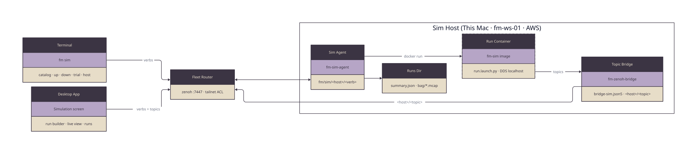
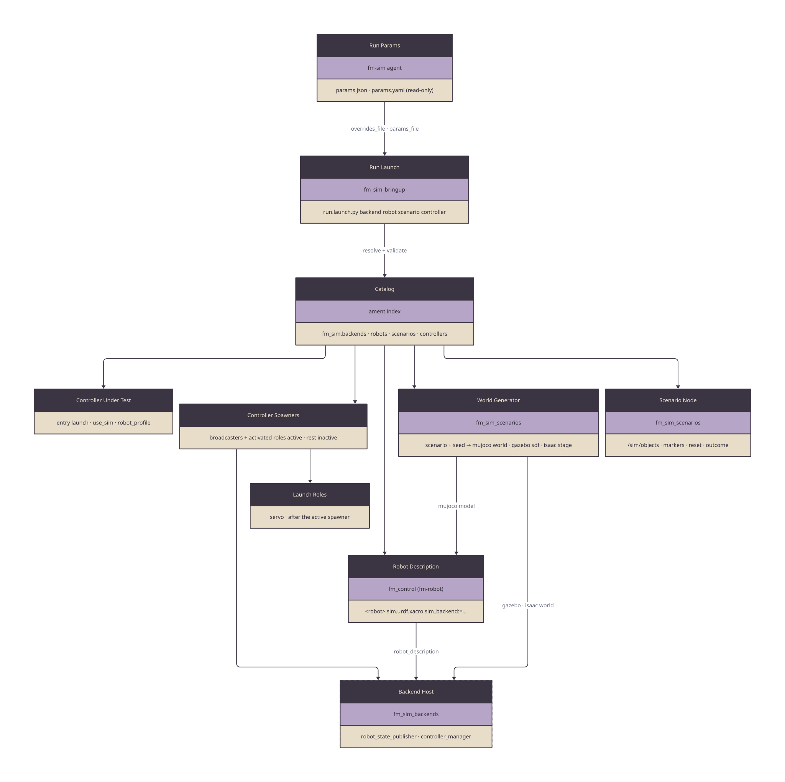
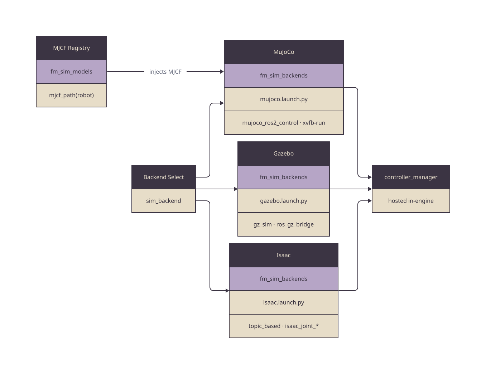
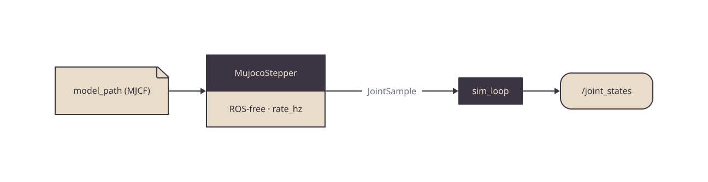
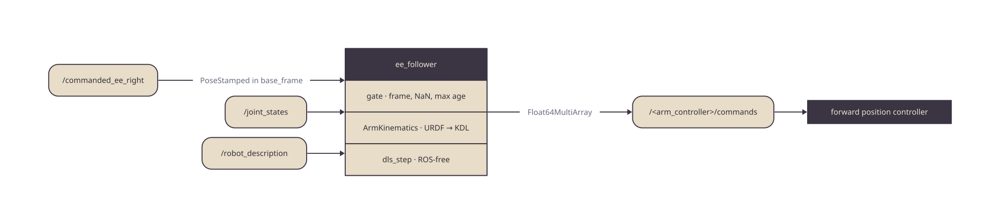

# Architecture

The simulation layer of First Motive's ROS2 stack. One launch runs a backend, a
robot, a scenario and a controller together; a sim agent on each sim host runs
that launch in a container, and the `fm sim` CLI and the desktop app drive the
agent over the fleet's Zenoh fabric. Inside the launch, each engine hosts a
`controller_manager`, so the same controllers drive any backend, and the
physics stepper of the headless dev loop stays ROS-free and testable in isolation.

This repo is the sim layer, on ROS2 Jazzy only (Humble sim is retired). The robot
descriptions it hosts come from
[`fm-robot`](https://github.com/first-motive/fm-robot):
`fm_control/urdf/<robot>.sim.urdf.xacro`, whose `sim_backend:=mock|mujoco|gz|gazebo|isaac|real`
arg selects the `<hardware>` plugin and fails on any other value. For the
system-wide view see [`fm-ros2`](https://github.com/first-motive/fm-ros2).

## System



Source: [`diagrams/hosts.d2`](diagrams/hosts.d2).

A client sends a verb to `fm/sim/<host>/<verb>` through the fleet router. The
host's agent starts the run as a container of the fm-sim image, which runs
`run.launch.py` with DDS discovery kept to the host. The host's zenoh bridge
carries the run's topics to the router under the host's namespace, where the
desktop app subscribes to them. The CLI and the app are clients of the same
agent, so a run either one starts shows in both.

| Term | Meaning |
|------|---------|
| Sim host | A machine whose sim agent answers on `fm/sim/<host>/*`: this Mac, fm-ws-01 or the AWS host. It runs one run at a time |
| Run | One `run.launch.py` container, named by `run_id` = `<UTC yyyymmddThhmmss>-<backend>-<robot>-<scenario>-<controller>-<seed>` |
| Catalog entry | A named backend, robot, scenario or controller registered in the ament index; the four dimensions of a run |
| Scenario | A backend-neutral world: objects, regions, seeded spawn ranges and a success predicate |
| Controller entry | The controller under test: the robot roles it activates and the launch it adds |
| Controller role | A named set of the robot's ros2_control controllers, such as `arm_trajectory` |
| Launch role | A robot role that is a node rather than a controller, such as OpenArm's `servo` |
| Run summary | The JSON record the agent writes for every run: spec, times, outcome and metrics |

## Packages

| Package | Build | Responsibility |
|---------|-------|----------------|
| `fm_sim_core` | ament_python | Headless MuJoCo stepper + `sim_loop` node; physics split from ROS comms for testability |
| `fm_sim_backends` | ament_python | One launch file per engine (MuJoCo, Gazebo, Isaac), each hosting a `controller_manager` |
| `fm_sim_models` | ament_python | MJCF model registry — single source of truth mapping robot key → MuJoCo model path; vendored models resolve under `/ws/external`, while `axol`'s committed MJCF resolves from this package's share |
| `fm_sim_ee_follower` | ament_python | `ee_follower` node: damped-least-squares IK from `/commanded_ee_right` to the right arm's forward position controller, standing in for the loader's IK; ROS-free DLS core |
| `fm_sim_bringup` | ament_python | `run.launch.py` and the catalog of backends, robots, scenarios and controllers, resolved from the ament index |
| `fm_sim_scenarios` | ament_python | Backend-neutral scenario logic (seeded spawns, success predicate), the per-backend world generators (MuJoCo, Gazebo, and the Isaac Sim stage spec) and the scenario node serving `/sim/objects`, `/sim/markers`, `/sim/reset`, `/sim/outcome` |
| `fm_sim_cameras` | ament_python | Simulated cameras as the real ones publish them: camera mounts from the description, the fisheye warp of a pinhole render, and the `sim_camera` node publishing `/cam_<role>/image_raw/compressed` and `/cam_<role>/camera_info` |
| `fm_sim_msgs` | ament_cmake | The scenario interfaces: `ObjectState(s)`, `Outcome`, `Reset` |
| `fm_sim` | ament_cmake (meta) | Metapackage tying the eight together for a single install |

Two parts sit outside colcon. [`agent/`](../agent/README.md) is a uv project:
the sim agent and the `fm sim` CLI. [`infra/aws/sim/`](../infra/aws/sim/README.md)
is the CloudFormation stack for the AWS sim host.

## Run Contract

`fm_sim_bringup/run.launch.py` takes four names, `backend`, `robot`, `scenario` and
`controller`, plus `use_sim`, `seed` and `timeout_s`. Each is an entry in an ament resource type
(`fm_sim.backends`, `fm_sim.robots`, `fm_sim.scenarios`, `fm_sim.controllers`)
whose content points at the entry's yaml, so any package registers an entry by
installing two files. The launch validates all four, expands the robot's fm-robot
xacro with the backend's args, includes the backend host, spawns the robot's
controllers by role, starts the launch roles the controller activates, and
includes the controller's own launch. It first builds the scenario into a
world for that seed on every backend, and a scenario with objects adds the
scenario node. The seven steps, in order, are in
[`fm_sim_bringup`](../fm_sim_bringup/README.md#run-contract).



Source: [`diagrams/run.d2`](diagrams/run.d2). Entry fields, the `catalog --json`
output and its schema: [`fm_sim_bringup`](../fm_sim_bringup/README.md#catalog).
An entry may also declare `params`, tunables a run overrides by
`<dimension>.<name>`: [Run Params](../fm_sim_bringup/README.md#run-params).
An unknown name fails before anything starts and lists the registered ones; an
entry marked `available: false` is listed but refused, as is one whose
`requires_packages` are not all installed, and so is a robot on a backend missing
from its `supported_backends`. The `openarm` robot requires the private
`openarm_v2_anvil_description`, so it runs in the private fm-sim-controllers image
and is listed as unavailable in the public fm-sim image.

### The Four Dimensions

| Dimension | Resource type | Entries | Registered by |
|-----------|---------------|---------|---------------|
| Backend | `fm_sim.backends` | `mujoco`, `gazebo`, `isaac` | `fm_sim_backends` |
| Robot | `fm_sim.robots` | `openarm`, `so101`, `axol` | `fm_sim_bringup` |
| Scenario | `fm_sim.scenarios` | `empty`, `can_on_table`, `table_only`, `tabletop_can`, `tabletop_block`, `tabletop_puck` | `fm_sim_bringup` |
| Controller | `fm_sim.controllers` | `idle`, `teleop` | `fm_sim_bringup` |
| | | `fm_skills_classical`; `fm_skills_learned` (unavailable), family `fm_skills` | fm-skills `fm_skills_sim` |
| | | `anvil_classical` (unavailable), family `anvil` | anvil-embodied-ai `classical_control` |
| | | `act`, `smolvla`, `pi0` (unavailable) | anvil-embodied-ai `lerobot_control` |
| | | `policy_serve`; `fastwam` (placeholder, unavailable) | fm-teleop `fm_teleop_policy` |

An entry joins the catalog wherever its package is installed beside
`fm_sim_bringup`. A sim host's agent reads the catalog from the image it runs.
The public fm-sim image builds only this repo and the externals in
`fm-sim.repos`, so it offers `idle` and `teleop` alone. The private
`ghcr.io/first-motive/fm-sim-controllers:jazzy` image, built from fm-skills'
`docker/sim-controllers.Dockerfile`, adds a colcon overlay with
`fm_skills_classical`, `fm_skills_learned`, `anvil_classical`, `policy_serve` and
`fastwam`; a host selects it with `FM_SIM_IMAGE` and pins it with
`FM_SIM_IMAGE_DIGEST`. An unavailable entry's `description`
says why it is refused, and `ros2 run fm_sim_bringup catalog` prints it.

### Scenario Topics

On the sim host's ROS graph, with `use_sim_time` everywhere:

| Name | Type | Notes |
|------|------|-------|
| `/sim/objects` | `fm_sim_msgs/ObjectStates` | Ground-truth object poses, frame `world` |
| `/sim/markers` | `visualization_msgs/MarkerArray` | Objects and regions for a viewer |
| `/sim/reset` | `fm_sim_msgs/srv/Reset` | Respawns the objects for a seed. Not bridged: a remote caller uses the agent's `reset` verb |
| `/sim/outcome` | `fm_sim_msgs/Outcome` | Transient local, one per episode |
| `/clock`, `/joint_states`, `/tf`, `/tf_static` | standard | |
| `/cam_<role>/image_raw/compressed`, `/cam_<role>/camera_info` | `sensor_msgs` | Roles `chest` and `wrist_right`, with the real intrinsics |
| `/commanded_ee_right` | `geometry_msgs/PoseStamped` | EE follower input, in the profile's `base_frame` |

A scenario with no objects (`empty`) starts no scenario node, so it has no
`/sim/reset` or `/sim/outcome`. Behaviour of each topic:
[Scenarios](../fm_sim_bringup/README.md#scenarios) and
[Cameras](../fm_sim_bringup/README.md#cameras).

The host's bridge carries only an allowlist off the host: the topics above
except `/sim/reset` and `/commanded_ee_right`, plus `/rosout`, `/task/events`
and fm-skills' `/perception/*` poses, with cameras capped at 10 Hz. The
allowlist is `zenoh/bridge-sim.json5` in
[fm-comms](https://github.com/first-motive/fm-comms), so a new topic for the app
means editing that file as well.

## Backend Hosts

A robot bringup picks a backend by its `sim_backend` argument and includes the
matching `fm_sim_backends` launch file. Each launch file hosts a
`controller_manager` inside its engine, so the controllers above the hardware
interface are identical across every backend. Each one also runs the
`robot_state_publisher`: the Jazzy `controller_manager` reads the description
from the `/robot_description` topic, never from a node parameter.



Source: [`diagrams/backends.d2`](diagrams/backends.d2).

| Backend | Launch file | Hosts | Notes |
|---------|-------------|-------|-------|
| `mujoco` | `mujoco.launch.py` | `mujoco_ros2_control/ros2_control_node`, headless; its CameraPlugin renders on EGL, or as `MUJOCO_GL` says | **Daily driver**, native arm64 on M5 (CPU, no GPU) |
| `gazebo` | `gazebo.launch.py` | Gazebo Harmonic: `gz sim` in its own process group, `create`, `ros_gz_bridge` (clock, object poses, camera images, `set_pose`); `gz_ros2_control` in-engine | Linux/GPU, or server-only with headless rendering anywhere. Runs the generated world SDF, the robot with camera sensors, and the camera relays |
| `isaac` | `isaac.launch.py` | standalone `controller_manager` with `topic_based_ros2_control`, bridged over `/isaac_joint_states` ↔ `/isaac_joint_commands` | Linux + NVIDIA. Builds the Isaac Sim 4.5 stage (URDF, objects, cameras, ROS 2 bridge graph) and starts Isaac when `FM_ISAAC_PYTHON` is set and a world is given. Under the agent, Isaac runs in its own container beside the run (agent README, Isaac Runs) |

`topic_based_ros2_control` has no Jazzy apt release, so `fm-sim.repos` pins it as
a source external that CI and the image build.

The `mock` and `real` backends do not live here — a robot bringup spawns a
standalone `controller_manager` for them directly. The `<hardware>` plugin each
backend binds to is defined in [`fm-robot`](https://github.com/first-motive/fm-robot)
(`fm_control`); this layer provides the engine hosts, not the interface.

## Host Verification

ROS2 Jazzy has no native macOS build, so on a Mac every backend runs inside the
fm-docker Linux container (OrbStack) — there is no native-Mac path for any sim
engine. Linux runs bare-metal native. `run.sh` picks the path from the host OS;
`scripts/smoke.sh` drives the matrix on a Mac and the `image` CI job drives it
in the built image on amd64 and arm64 ubuntu.

| Backend | macOS (container) | Linux (native) | How it comes up headless |
|---------|-------------------|----------------|--------------------------|
| `mock` | headless | yes | `sim_loop`, no engine |
| `mujoco` | headless | yes | `ros2_control_node` headless; cameras on EGL with no display (`MUJOCO_GL=osmesa` forces Mesa's software rasteriser) |
| `gazebo` | headless | yes (GPU) | `gz -s` server-only, software GL |
| `isaac` | — | yes (NVIDIA) | not on macOS — Isaac Sim is Linux + NVIDIA |

On Jazzy, Gazebo Harmonic ships arm64 binaries, and `gazebo` runs headless on
arm64 under software GL. `smoke.sh` still captures PASS / SKIP / FAIL rather than
assuming success, and the amd64 and arm64 CI lanes cover the same matrix.

`isaac` is out on macOS by design. The Isaac Sim application is Linux + NVIDIA
only and never runs on Apple silicon or the container base image; only its topic
bridge node is portable, and that stays on the Linux/NVIDIA host. There is no
macOS isaac code, by intent — not an omission.

## MJCF Registry

`fm_sim_models.mjcf_path(robot_key)` is the sole source of MuJoCo model paths — no
path is hardcoded in any xacro. With `sim_backend:=mujoco`, the caller expanding
fm-robot's sim xacro passes the looked-up path as its `mujoco_model` argument.

| Robot key | MJCF | Status |
|-----------|------|--------|
| `openarm_anvil` | Compiled at run time from the installed `openarm_v2_anvil_description` URDF, with actuators, joint damping, contact excludes and noslip patched in | The `openarm` catalog robot; matches fm-robot's `openarm_loader.sim.urdf.xacro`. Private: only where the description is installed |
| `openarm` | `openarm_mujoco/v2/openarm_bimanual.xml`, patched to the loader hand | Matches fm-robot's `openarm.sim.urdf.xacro` with `hand:=loader`; no catalog entry runs it now |
| `openarm_pinch` | `openarm_mujoco/v2/openarm_bimanual.xml` | Stock v2.0 pinch gripper; matches `hand:=pinch` |
| `so101` | `so_arm/Simulation/SO101/so101_new_calib.xml` | Joint names match system |
| `g1_d` | `unitree_mujoco/.../g1_29dof.xml` | Wired, not yet validated — bipedal legs differ from wheeled G1-D |
| `axol` | `models/axol/axol.xml` (package share) | Almond Bot Axol, bimanual 2×7-DOF — mujoco validated; real CAN deferred |

Most models are vendored under `external/` (gitignored on host, mounted at `/ws` in
the dev container) via `fm-sim.repos`. `axol` is the exception: it has no upstream
MJCF, so First Motive compiled one from `axol.urdf` and committed it into
`fm_sim_models`' share at `models/axol/axol.xml`; the registry resolves it from the
package share rather than `/ws/external`.

## Headless Dev Loop

`fm_sim_core` runs a different, lighter path: a headless control loop with no
controllers and no `ros2_control`. The `MujocoStepper` is ROS-free — it owns a
loaded model, steps it, and returns a `JointSample`. The `sim_loop` node wraps it
and publishes `/joint_states`.



Source: [`diagrams/sim_loop.d2`](diagrams/sim_loop.d2).

| Parameter | Type | Default | Role |
|-----------|------|---------|------|
| `model_path` | string | `""` (1-DOF fallback model) | MJCF to step |
| `rate_hz` | double | `100.0` | Step + publish frequency |

The stepper takes an injected `mujoco` module, so unit tests run against a fake —
no native wheel required.

## EE Follower

On the real OpenArm, the Anvil loader turns a commanded tool pose into joint commands.
In the sim, `fm_sim_ee_follower`'s `ee_follower` node does that job: it reads
`/commanded_ee_right` (`PoseStamped` in the profile's `base_frame`), takes one
damped-least-squares step per tick from `/joint_states`, and streams the result to the
right arm's forward position controller. Missing, stale or non-finite input means no
command that tick, and a command in another frame clears the last good one. See the
[package README](../fm_sim_ee_follower/README.md).



Source: [`diagrams/ee_follower.d2`](diagrams/ee_follower.d2).

## Sim Agent

[`agent/`](../agent/README.md) serves one Zenoh queryable per verb under
`fm/sim/<host>/<verb>`, where `<host>` is the machine name with `-` as `_`
(`fm_ws_01`). Bodies are UTF-8 JSON. A reply is `{"ok": true, ...}`; a refusal
is a Zenoh error reply carrying `{"ok": false, "error": {"code", "message"}}`.

| Verb | Kind | Request | Reply |
|------|------|---------|-------|
| `status` | queryable, and published at 1 Hz | none | host, state, `run_id`, spec, since, version |
| `catalog` | queryable | none | the image's `catalog --json` |
| `up` | queryable | RunSpec `{backend, robot, scenario, controller, seed, record, params?}` | `run_id` |
| `down` | queryable | optional `run_id` | the run summary |
| `reset` | queryable | `seed` | ok; calls the run's `/sim/reset` |
| `runs` | queryable | optional `limit` | run summaries, newest first |
| `logs` | published on `fm/sim/<host>/logs/<run_id>` | none | one `{t, level, node, msg}` record per line |

```
idle ─up─▶ starting ─broadcasters active─▶ running ─down─▶ stopping ─▶ idle
              └── start fails · not ready in 180 s · container exits ──▶ error
```

A run is ready once `controller_manager` lists the robot's broadcasters active;
the agent then applies the seed through `/sim/reset` when the scenario serves it,
and starts the MCAP recorder when `record` is true. `error` holds no run, so the
next `up` is accepted. Every run writes a summary; only a recorded run writes an
MCAP. Run lifecycle, on-disk layout and flags:
[the agent's README](../agent/README.md#a-run).

| Code | Refused because |
|------|-----------------|
| `invalid_request` | The body is too large, not a JSON object, or a field is malformed |
| `invalid_spec` | The RunSpec has a bad name, seed or flag, an extra key, or a `params` override no entry declares or its tunable refuses |
| `unknown_entry` | A name is not in the image's catalog |
| `unavailable_entry` | The entry is `available: false`, or the four entries do not go together: a backend the robot does not list in `supported_backends`, a controller with a launch on a robot with no `robot_profile`, or a controller activating a role the robot lacks. The message names which; the code stays one so clients already in the field read it |
| `catalog_unavailable` | The catalog could not be read from the image, or the robot names no broadcasters |
| `busy` | A run is active or stopping, another process's run is up under the agent's label, or the query queue is full |
| `run_exists` | A run with that id already exists; retry a second later |
| `start_failed` | The container did not start |
| `insufficient_space` | The runs directory is below its free-space floor (10 GiB by default) or unreadable |
| `not_running` | `down` or `reset` with no active run |
| `run_mismatch` | `down` named a run that is not the active one |
| `reset_unavailable` | The run's scenario has no `/sim/reset` |
| `reset_failed` | The reset did not take |
| `unknown_verb` | The key names no verb |
| `internal_error` | The agent failed; its own log holds the detail |

## The fm sim CLI

`fm sim` is mounted from this repo's `fm.json` and runs the agent project's
client. Every verb takes `--host`: a machine name, or `local` for this machine.

```bash
fm sim catalog --host fm-ws-01
fm sim up      --host fm-ws-01 --scenario can_on_table --controller idle --seed 3 [--record]
fm sim logs    --host fm-ws-01
fm sim down    --host fm-ws-01
fm sim runs    --host fm-ws-01
fm sim trial   --host fm-ws-01 --seeds 0..19 [--run-timeout 300] [--report PATH]
fm sim host status|start|stop aws   --stack fm-sim-cloud-host
fm sim host status|pull|start|stop|restart local [--controllers]
```

`trial` runs one spec once per seed, scores each run on its `/sim/outcome`, and
writes a JSON report with the success rate. `host … aws` and `host … local`
manage the AWS and This Mac sim hosts below. `--json` prints the raw reply. Exit
codes: 0 success, 1 refused, 2 usage, 3 no router or no answer, 130
interrupted. Every verb and flag:
[The fm sim CLI](../agent/README.md#the-fm-sim-cli).

## Sim Hosts

| Host | Set up by | Serves | Backends | Notes |
|------|-----------|--------|----------|-------|
| This Mac | `fm sim host pull local`, then `start local` (or the desktop app's This Mac card) | `fm/sim/<this machine>/*` | MuJoCo, Gazebo (headless) | Runs in OrbStack or Docker, off the host network, each with a bridge container for its live topics. Needs `FM_ROUTER_ENDPOINT` and, for live topics, fm-comms' `bridge-sim.json5`. With no managed agent, `--host local` runs the agent in-process with no router |
| fm-ws-01 | fm-setup's `sim` workload: the image and agent at pinned versions, a systemd unit, and a machine card with `workload: sim` to select the sim bridge | `fm/sim/fm_ws_01/*` | MuJoCo, Gazebo, Isaac | The unit passes `--gpus` and a 32 GiB memory ceiling for Isaac Sim |
| AWS | [`infra/aws/sim`](../infra/aws/sim/README.md), started by `fm sim host start aws`; the instance provisions itself with fm-setup's `sim-cloud` role | `fm/sim/sim_cloud/*` | MuJoCo, Gazebo, Isaac | Zero or one `g6e.xlarge`; a budget gate refuses starts; idle 15 minutes returns it to zero; a deadline terminates it |

The image is `ghcr.io/first-motive/fm-sim:jazzy`. Its digest is pinned in
`agent/src/fm_sim_agent/service.py` (`DEFAULT_IMAGE_DIGEST`), which must match
fm-setup's `FM_SIM_IMAGE_DIGEST_DEFAULT`. This Mac can run the private
`ghcr.io/first-motive/fm-sim-controllers:jazzy` instead, pinned beside it
(`CONTROLLERS_IMAGE_DIGEST`), with `--controllers`. A run uses `--pull=never`, so the image must be on the host first.

On AWS, an instance in service is not yet a ready sim host: it is ready once its
agent answers `fm sim status --host sim-cloud`.

## Trust Boundary

The agent does not authenticate callers. It trusts the tailnet ACL on the fleet
router's port 7447, as fm-robot-agent does: **any tailnet node that can reach
:7447 can call every verb on every sim host**, including starting and stopping
runs. Per-caller authentication is a fleet-wide follow-up.

The agent's account runs Docker, which is root-equivalent, so the agent keeps
what a caller chooses narrow: four catalog names, a seed, a record flag and
overrides of the tunables the catalog declares, which reach the run as checked
values in read-only files. No caller value reaches a shell or a command line. Each run container runs as the agent's uid with
every capability dropped and process and memory ceilings, sees only its own
`bag/` directory (an isaac run also its `stage/`, which its Isaac container
shares under the same confinement), and keeps DDS discovery on the host, so no sim topic reaches a
real robot's graph on a shared LAN. Only the host's bridge carries topics off
it, and only its allowlist. On AWS the agent's account is also blocked from the
instance metadata service. Full list:
[Trust Boundary](../agent/README.md#trust-boundary).

## Extend The Catalog

Every entry is two installed files, so a package outside fm-sim registers one
with no change here:

```text
share/ament_index/resource_index/fm_sim.<kind>/<name>   content: <package>/catalog/<kind>/<name>.yaml
share/<package>/catalog/<kind>/<name>.yaml              the entry, schema-checked on every load
```

An `ament_python` package installs both through `data_files`, as
`fm_teleop_policy`'s `setup.py` in fm-teleop does. Names match
`^[A-Za-z][A-Za-z0-9_]*$`, and the yaml names itself `<name>`. Fields per kind:
[Catalog](../fm_sim_bringup/README.md#catalog).

**A controller.** Write the entry in the controller's own package: `activate`
names the robot's controller or launch roles it needs, and `launch` names the
launch file `run.launch.py` includes with `use_sim`, `robot_profile` and
`scenario`. Read joint, controller and frame names from the robot profile, never
from literals. Mark the entry `available: false`, with the reason in its
`description`, until it runs end to end. A new topic the app should see also
needs the bridge allowlist and the app's topic table.

**A scenario.** Add the yaml under `fm_sim_bringup/catalog/scenarios/`:
objects, regions and an `object_in_region` success predicate, with poses in the
description's world frame. The schema and the generators check it on load. A
scenario with objects runs on every backend.

**A robot.** It needs a `<robot>.sim.urdf.xacro` in fm-robot that takes
`sim_backend`, a MuJoCo model registered in `fm_sim_models`, a controllers file,
and a robot entry naming its `controller_roles` (with `broadcasters`), its
`supported_backends` and its `robot_profile`. A robot with no profile (`null`)
runs only controllers without a launch. Add the robot to
`test_run.py` and the live `test_run_launch.py` matrix.

## Not Yet On Main

| Work | State |
|------|-------|
| `fm_skills_classical` in sim | Available in the controllers image, planning on the same Anvil description the sim openarm runs; a live pick trial on the loader hand is still to pass |
| VLA controllers | `act`, `smolvla` and `pi0` need torch, so no image builds them; they wait for a GPU variant of the controllers image |
| Controllers image on a host | The image is private, so a host needs a ghcr login to pull it; a host runs it only when `--controllers` or `FM_SIM_CONTROLLERS=1` chooses it |

## Design Notes

| Principle | How it shows up | Payoff |
|-----------|-----------------|--------|
| **Physics split from ROS** | `MujocoStepper` (no ROS) + `SimLoop` (node wrapper) | Step logic unit-tests without rclpy or the native wheel |
| **One interface, many engines** | Each backend hosts a `controller_manager`; controllers are backend-agnostic | Sim ↔ sim ↔ real is a launch arg |
| **Single MJCF source** | `fm_sim_models.mjcf_path` is the only path lookup | No model path duplicated across xacros |
| **Catalog by registration** | Every run dimension is an ament index entry checked against one schema | A controller or robot joins from its own package |
| **One agent, many hosts** | The CLI and the app are both clients of the same Zenoh verbs on every sim host | A run started anywhere shows everywhere; a new host is an agent and a bridge |

Per-package detail lives in each `<package>/README.md`.
