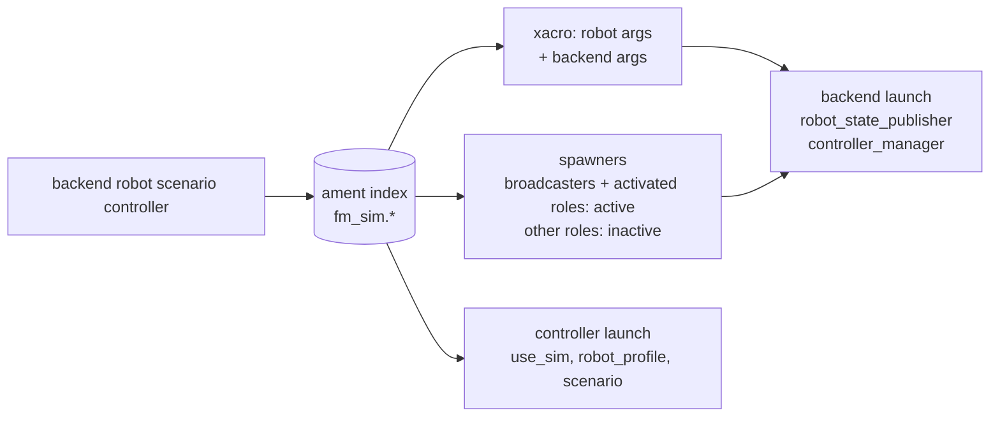

# fm_sim_bringup

The sim run contract: one `run.launch.py` that runs a backend, a robot, a scenario
and a controller together, and the catalog that registers what each of those four
can be. Every value comes from the ament resource index, so a package outside
fm-sim (a controller in fm-skills, say) joins the catalog by installing an entry,
with no change here.

## Run Contract

```bash
ros2 launch fm_sim_bringup run.launch.py \
  backend:=mujoco robot:=openarm scenario:=empty controller:=idle
```

| Argument | Default | Catalog type | Description |
|----------|---------|--------------|-------------|
| `backend` | `mujoco` | `fm_sim.backends` | Engine host from `fm_sim_backends` |
| `robot` | `openarm` | `fm_sim.robots` | Robot description, MJCF and controllers |
| `scenario` | `empty` | `fm_sim.scenarios` | Scene contents |
| `controller` | `idle` | `fm_sim.controllers` | Controller under test |
| `use_sim` | `true` | — | Passed to the controller's launch |

An unknown value fails before anything starts and lists the registered ones; an
entry marked `available: false` is listed but refused, and so is a robot on a
backend missing from its `supported_backends` (see [Known Gaps](#known-gaps)).
`use_sim` takes only `true` or `false`.



What `run.launch.py` does, in order:

1. Expands the robot's xacro with the robot's `description_args` and the backend's.
   The backend's args select its hardware plugin; `{mjcf_path}` (from
   `fm_sim_models`) and `{controllers_file}` are filled in.
2. Includes the backend launch with that description, the robot's controllers
   file and the backend's optional `launch_args` (gazebo's run server-only).
3. Spawns the robot's controllers. The `broadcasters` role and every role the
   controller entry `activate`s start active; the others load inactive, so a
   controller can switch to them.
4. Includes the controller entry's `launch`, if any, with `use_sim`,
   `robot_profile` and `scenario`.

The scenario is resolved and validated; `empty` adds nothing to the scene. The
scenario schema and its per-backend generators come next.

## Catalog

An entry is two installed files:

```text
share/ament_index/resource_index/fm_sim.<kind>/<name>   content: <package>/catalog/<kind>/<name>.yaml
share/<package>/catalog/<kind>/<name>.yaml              the entry
```

`<kind>` is `backends`, `robots`, `scenarios` or `controllers`. The `fm_sim.`
prefix keeps these resource types apart from any other package's. The entry yaml
must name itself `<name>` and match its definition in
[`schema/catalog.schema.json`](schema/catalog.schema.json), which is checked on
every load. Every path, the marker's content and each `{package, path}`, is
relative with no `..` segment and must stay inside that package's share as
written (symlinks are not followed, since `--symlink-install` links every share
file back to its source). An
`ament_python` package installs both through `data_files`; see this package's
`setup.py`.

| Kind | Registered here | Fields beyond `name`, `description`, `available` |
|------|-----------------|---------------------------------------------------|
| `backends` | `mujoco`, `gazebo`, `isaac` (by `fm_sim_backends`) | `launch`, `description_args`, optional `launch_args` |
| `robots` | `openarm` (`supported_backends: [mujoco, isaac]`) | `description_file`, `description_args`, `mjcf`, `controllers_file`, `controller_roles`, `robot_profile`, `supported_backends` |
| `scenarios` | `empty` | `objects` |
| `controllers` | `idle` | `activate`, `launch` |

The OpenArm entry expands fm-robot's `fm_control/urdf/openarm.sim.urdf.xacro`
(`default_bimanual`, `emit_grasp_frame:=true`) and owns the sim controllers file,
[`config/openarm/default_bimanual.controllers.yaml`](config/openarm/default_bimanual.controllers.yaml),
since fm-robot ships none. Its roles follow the `fm_openarm_v2` robot profile:

| Role | Controllers |
|------|-------------|
| `broadcasters` | `joint_state_broadcaster` |
| `arm_trajectory` | `openarm_{left,right}_arm_controller` (JTC) |
| `arm_forward_position` | `openarm_{left,right}_forward_position_controller` |
| `gripper` | `openarm_{left,right}_gripper_controller` (JTC) |

### `catalog`

```bash
ros2 run fm_sim_bringup catalog          # one line per entry
ros2 run fm_sim_bringup catalog --json   # the whole catalog
```

`--json` prints `{"schema_version": 1, "backends": [...], "robots": [...],
"scenarios": [...], "controllers": [...]}`, each entry being its yaml plus the
`package` that registered it. `schema/catalog.schema.json` (JSON Schema draft-07)
is the contract for that output.

## Tests

| Test | Checks |
|------|--------|
| `test_catalog.py` | Lookup, unknown and unavailable entries, schema validation, `catalog --json` against the schema, path confinement, robot roles against the controllers file |
| `test_run.py` | Description args, active and inactive controller sets, unknown values, unsupported robot-backend pairs |
| `test_run_launch.py` | Live: `openarm` on `mujoco`, `empty`, `idle` — broadcaster active, the other six controllers inactive. Needs the `openarm_mujoco` external and `xvfb-run` |

## Known Gaps

- `openarm` on `gazebo` (left out of its `supported_backends`, so `run.launch.py`
  refuses the pair): the server starts and the robot spawns, but the
  gz_ros2_control `controller_manager` stays at "Waiting RM to load and initialize
  hardware". A one-joint robot comes up on the same backend, so the suspect is the
  description's two `<ros2_control>` systems (one per arm). The Gazebo generator
  step takes this up.
- `openarm` on `mujoco`: each arm's `<ros2_control>` system loads its own copy of
  the MJCF, so the two arms step in separate MuJoCo worlds. Joint states and
  controllers work; contact between the arms, or with scenario objects, needs one
  system for both arms in fm-robot's xacro.

## Build Type

`ament_python`. One console script, `catalog`. fm-robot's `fm_control` is an exec
dependency (the OpenArm xacro); `fm-sim.repos` builds it from source.
