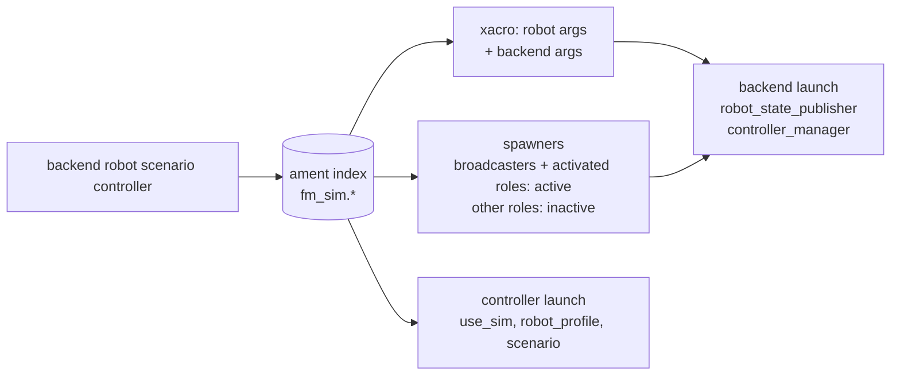

# fm_sim_bringup

The sim run contract: one `run.launch.py` that runs a backend, a robot, a scenario
and a controller together, and the catalog that registers what each of those four
can be. Every value comes from the ament resource index, so a package outside
fm-sim (a controller in fm-skills, say) joins the catalog by installing an entry,
with no change here.

## Run Contract

```bash
ros2 launch fm_sim_bringup run.launch.py \
  backend:=mujoco robot:=openarm scenario:=empty controller:=idle
```

| Argument | Default | Catalog type | Description |
|----------|---------|--------------|-------------|
| `backend` | `mujoco` | `fm_sim.backends` | Engine host from `fm_sim_backends` |
| `robot` | `openarm` | `fm_sim.robots` | Robot description, MJCF and controllers |
| `scenario` | `empty` | `fm_sim.scenarios` | Scene contents |
| `controller` | `idle` | `fm_sim.controllers` | Controller under test |
| `use_sim` | `true` | — | Passed to the controller's launch |

An unknown value fails before anything starts and lists the registered ones; an
entry marked `available: false` is listed but refused, and so is a robot on a
backend missing from its `supported_backends`.
`use_sim` takes only `true` or `false`.



What `run.launch.py` does, in order:

1. Expands the robot's xacro with the robot's `description_args` and the backend's.
   The backend's args select its hardware plugin; `{mjcf_path}` (from
   `fm_sim_models`) and `{controllers_file}` are filled in.
2. Includes the backend launch with that description, the robot's controllers
   file and the backend's optional `launch_args` (gazebo's run server-only).
3. Spawns the robot's controllers. The `broadcasters` role and every role the
   controller entry `activate`s start active; the others load inactive, so a
   controller can switch to them.
4. Includes each launch role the controller entry `activate`s (the robot's
   `launch_roles`, below) once the active spawner has exited cleanly, with the
   role's `launch_args` and the run's `robot_description`. A launch role's
   `requires` roles start active with it, and a role listed twice starts once. If
   the spawner fails, the run shuts down.
5. Includes the controller entry's `launch`, if any, with `use_sim`,
   `robot_profile` and `scenario`. A robot whose `robot_profile` is `null` refuses
   a controller with a `launch`, since that launch reads its names from the profile.

The scenario is resolved and validated; `empty` adds nothing to the scene. The
scenario schema and its per-backend generators come next.

## Catalog

An entry is two installed files:

```text
share/ament_index/resource_index/fm_sim.<kind>/<name>   content: <package>/catalog/<kind>/<name>.yaml
share/<package>/catalog/<kind>/<name>.yaml              the entry
```

`<kind>` is `backends`, `robots`, `scenarios` or `controllers`. The `fm_sim.`
prefix keeps these resource types apart from any other package's. The entry yaml
must name itself `<name>` and match its definition in
[`schema/catalog.schema.json`](schema/catalog.schema.json), which is checked on
every load. Every path, the marker's content and each `{package, path}`, is
relative with no `..` segment and must stay inside that package's share as
written (symlinks are not followed, since `--symlink-install` links every share
file back to its source). An
`ament_python` package installs both through `data_files`; see this package's
`setup.py`.

| Kind | Registered here | Fields beyond `name`, `description`, `available` |
|------|-----------------|---------------------------------------------------|
| `backends` | `mujoco`, `gazebo`, `isaac` (by `fm_sim_backends`) | `launch`, `description_args`, optional `launch_args` |
| `robots` | `openarm`, `so101`, `axol` (each `supported_backends: [mujoco, gazebo, isaac]`) | `description_file`, `description_args`, `mjcf`, `controllers_file`, `controller_roles`, `robot_profile`, `supported_backends`, optional `launch_roles` |
| `scenarios` | `empty` | `objects` |
| `controllers` | `idle`, `teleop` | `activate`, `launch` |

The OpenArm entry expands fm-robot's `fm_control/urdf/openarm.sim.urdf.xacro`
(`default_bimanual`, `emit_grasp_frame:=true`) and owns the sim controllers file,
[`config/openarm/default_bimanual.controllers.yaml`](config/openarm/default_bimanual.controllers.yaml),
since fm-robot ships none. Its roles follow the `fm_openarm_v2` robot profile:

| Role | Controllers |
|------|-------------|
| `broadcasters` | `joint_state_broadcaster` |
| `arm_trajectory` | `openarm_{left,right}_arm_controller` (JTC) |
| `arm_forward_position` | `openarm_{left,right}_forward_position_controller` |
| `gripper` | `openarm_{left,right}_gripper_controller` (JTC) |

A controller entry's `activate` names controller roles or launch roles; any other
name fails the run. The schema checks each launch role's shape on load; whether its
`requires` are controller roles, and whether a name is in both maps, is checked
when a run resolves the robot. OpenArm has one launch role:

| Launch role | Requires | Starts |
|-------------|----------|--------|
| `servo` | `arm_trajectory` | fm-robot's `fm_control/launch/openarm_sim_servo.launch.py` with `sim_only:=true`, `command_type:=joint_jog`: sim-only MoveIt Servo on `/servo_node`, streaming to `openarm_right_arm_controller`. That launch refuses to start unless ROS discovery is host-local (`ROS_AUTOMATIC_DISCOVERY_RANGE=LOCALHOST`, as the fm-sim agent sets) |

The SO-101 and Axol entries expand fm-robot's `so101.sim.urdf.xacro` and
`axol.sim.urdf.xacro` with no extra args, and own their controllers files under
`config/so101/` and `config/axol/`, named as fm_ros2's `fm_bringup` names them. No
robot profile describes either yet, so their `robot_profile` is `null`.

| Robot | `arm_trajectory` | `gripper` |
|-------|------------------|-----------|
| `so101` | `so101_arm_controller` | `so101_gripper_controller` |
| `axol` | `axol_{left,right}_arm_controller` | none (the grippers are fixed) |

Both also have `broadcasters: [joint_state_broadcaster]`. On Gazebo their meshes
do not resolve yet (the SO-101 URDF's are relative, the Axol's
`package://assembly/...`), so the arms load with no visual or collision geometry;
the controllers still come up.

| Controller | Activates | Launch |
|------------|-----------|--------|
| `idle` | nothing beyond the broadcasters | none |
| `teleop` | `arm_trajectory`, for an operator's teleop source such as fm-teleop's leader source, which runs outside this launch | none |

### `catalog`

```bash
ros2 run fm_sim_bringup catalog          # one line per entry
ros2 run fm_sim_bringup catalog --json   # the whole catalog
```

`--json` prints `{"schema_version": 1, "backends": [...], "robots": [...],
"scenarios": [...], "controllers": [...]}`, each entry being its yaml plus the
`package` that registered it. `schema/catalog.schema.json` (JSON Schema draft-07)
is the contract for that output.

## Tests

| Test | Checks |
|------|--------|
| `test_catalog.py` | Lookup, unknown and unavailable entries, schema validation (`robot_profile` a name or `null`), `catalog --json` against the schema, path confinement, robot roles against the controllers file |
| `test_run.py` | Description args, active and inactive controller sets for `idle` and `teleop` on every robot, launch roles and what they require, unknown values, unsupported robot-backend pairs, a launch controller on a robot with no profile |
| `test_run_launch_roles.py` | `run.launch.py`'s setup with a controller that activates `servo`: Servo waits on the active spawner and gets the run's description and `sim_only:=true`; a failed spawner shuts the run down |
| `test_run_launch.py` | Live: every robot on `mujoco`, `gazebo` (server-only) and `isaac` (no Isaac Sim running), `empty`, `idle` — broadcaster active, every other controller inactive, all joints in one hardware component on the simulators and the per-arm systems on Isaac. Each row runs on its own ROS domain and Gazebo partition. Needs the MJCF and description externals, `topic_based_ros2_control` and `xvfb-run` |

## Build Type

`ament_python`. One console script, `catalog`. fm-robot's `fm_control` is an exec
dependency (the robot xacros and OpenArm's sim Servo launch); `fm-sim.repos` builds it
from source.
