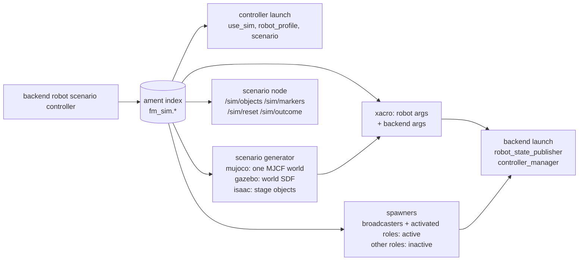
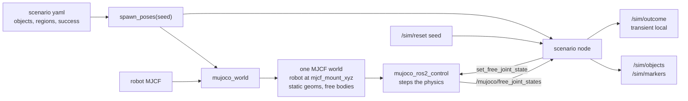

# fm_sim_bringup

The sim run contract: one `run.launch.py` that runs a backend, a robot, a scenario
and a controller together, and the catalog that registers what each of those four
can be. Every value comes from the ament resource index, so a package outside
fm-sim (a controller in fm-skills, say) joins the catalog by installing an entry,
with no change here.

## Run Contract

```bash
ros2 launch fm_sim_bringup run.launch.py \
  backend:=mujoco robot:=so101 scenario:=empty controller:=idle
```

| Argument | Default | Catalog type | Description |
|----------|---------|--------------|-------------|
| `backend` | `mujoco` | `fm_sim.backends` | Engine host from `fm_sim_backends` |
| `robot` | `so101` | `fm_sim.robots` | Robot description, MJCF and controllers |
| `scenario` | `empty` | `fm_sim.scenarios` | Scene contents |
| `controller` | `idle` | `fm_sim.controllers` | Controller under test |
| `use_sim` | `true` | — | Passed to the controller's launch |
| `seed` | `0` | — | Spawn seed for the scenario's objects, an integer in [0, 2^32 - 1] |
| `timeout_s` | empty | — | Episode timeout in seconds; empty keeps the scenario's |

An unknown value fails before anything starts and lists the registered ones; an
entry marked `available: false` is listed but refused, as is one whose
`requires_packages` are not all installed (the error names the missing ones), and
so is a robot on a backend missing from its `supported_backends`.
`use_sim` takes only `true` or `false`; `seed` and `timeout_s` refuse anything
outside their ranges.



What `run.launch.py` does, in order:

1. On a backend with a scenario generator, spawns the scenario's objects from
   `seed` into a generated world (see [Scenarios](#scenarios)): on mujoco the
   robot's MJCF and the objects as one world; on gazebo the world SDF and on
   isaac the scenario half of the Isaac stage, which the backend launch
   completes. A backend without one runs the robot's own model and refuses a
   scenario that has objects.
2. Expands the robot's xacro with the robot's `description_args` and the backend's.
   The backend's args select its hardware plugin; `{mjcf_path}` (the generated
   world, or the robot's model from `fm_sim_models`) and `{controllers_file}` are
   filled in.
3. Includes the backend launch with that description, the robot's controllers
   file and the backend's optional `launch_args` (gazebo's run server-only). A
   backend that finishes its own stage (`run.STAGE_BACKENDS`: gazebo, isaac) also
   gets the generated `world` and the robot's `cameras_file` (each empty without
   one), its `mesh_roots` resolved to share directories, as JSON, and the robot
   entry's name as `robot` (gazebo names the spawned model with it).
4. Spawns the robot's controllers. The `broadcasters` role and every role the
   controller entry `activate`s start active; the others load inactive, so a
   controller can switch to them.
5. Includes each launch role the controller entry `activate`s (the robot's
   `launch_roles`, below) once the active spawner has exited cleanly, with the
   role's `launch_args` and the run's `robot_description`. A launch role's
   `requires` roles start active with it, and a role listed twice starts once. If
   the spawner fails, the run shuts down.
6. Includes the controller entry's `launch`, if any, with `use_sim`,
   `robot_profile` and `scenario`. A robot whose `robot_profile` is `null` refuses
   a controller with a `launch`, since that launch reads its names from the profile.
7. For a scenario with objects, starts the scenario node (`fm_sim_scenarios`) with
   `use_sim_time`. `empty` has none, so it has no `/sim/reset` or `/sim/outcome`.

## Scenarios

A scenario entry is backend-neutral: objects, regions and a success predicate,
with poses in the robot description's world frame (for OpenArm, the
`loader_openarm_v2` profile's `base_frame`, `follower_body_link0`, which sits on it). Each backend has a
generator that turns robot model + scenario + seed into the world its engine
loads; MuJoCo's is `fm_sim_scenarios.mujoco_world`, Gazebo's
`fm_sim_scenarios.gazebo_world` (see the [Gazebo backend](../fm_sim_backends/README.md#gazebo-world)), Isaac Sim's
`fm_sim_scenarios.isaac_stage` (see the [Isaac backend](../fm_sim_backends/README.md#isaac-stage)). The scenario node is the
same on every backend apart from how it reads and moves objects.



| Field | Meaning |
|-------|---------|
| `objects[]` | `name`, `shape` (`box` full extents, `cylinder` radius and height, `sphere` radius), `size`, `friction` (sliding), `color` (rgba), `pose` (`xyz`, optional `rpy`). Not `static`: also `mass`, and optional `spawn` ranges |
| `objects[].static` | Fixed to the world: a geom with no joint, never respawned |
| `objects[].spawn` | `x`, `y`, `z`, `yaw` as `[low, high]`: uniform offsets added to `pose`, drawn from `seed`: objects in yaml order, per object in x, y, z, yaw order |
| `regions[]` | `name`, `size` (full extents), `pose`, `color`: a box volume, drawn as a marker, never a body |
| `success` | `type: object_in_region`: `object`'s origin stays inside `region` grown by `tolerance` for `hold_s`, moving no faster than the optional `max_speed` (m/s); the episode fails at `timeout_s` |

Names match `^[A-Za-z][A-Za-z0-9_]*$` and are unique across objects and
regions; the success references and spawn ranges are checked on every load.

The MuJoCo world attaches the robot model unchanged (`<model>` asset and
`<attach>`), so its own compiler settings and relative mesh paths still resolve,
inside a frame at the robot entry's `mjcf_mount_xyz`. That puts the MuJoCo world
on the description's root frame (OpenArm's model is compiled from its description,
so the two origins already coincide and the mount is the default). Contact parameters: an object geom's friction
is its sliding coefficient with MuJoCo's default torsional and rolling terms; its
priority (2) is above the robot's collision geoms (1), so the object's friction
governs finger contacts; a free object uses `condim` 4 (torsional friction). The
world is written to a new `fm_sim_world_*` temporary directory per launch.

| Topic or service | Type | Behaviour |
|------------------|------|-----------|
| `/sim/objects` | `fm_sim_msgs/ObjectStates` | Every object, frame `world`, on each engine pose update (30 Hz of sim time on MuJoCo); static objects from their yaml pose |
| `/sim/markers` | `visualization_msgs/MarkerArray` | Namespace `objects` (one per object, by yaml index) and `regions` |
| `/sim/reset` | `fm_sim_msgs/srv/Reset` | Moves every free object to `spawn_poses(seed)` with zero velocity and starts a new episode under that seed; the old episode gives no verdict while objects move. `ok: false` with a message, keeping the old seed and episode, when the engine's service is not up yet, refuses, raises, or does not answer in 5 s |
| `/sim/outcome` | `fm_sim_msgs/Outcome` | Transient local, one per episode: success once the predicate holds, failure at the timeout. Episodes are timed in sim seconds; the first opens with the first `/clock` |

On MuJoCo the node reads poses from mujoco_ros2_control's
`FreeJointStatePublisherPlugin`, which `fm_sim_backends`' mujoco launch always
loads, and moves objects through `/mujoco_ros2_control_node/set_free_joint_state`.
The robot is not reset; a controller under test returns it to its start.

| Scenario | Objects | Success |
|----------|---------|---------|
| `empty` | none | none |
| `can_on_table` | `table` (top at 0.207), `paper` (A4), `can` (66 mm x 135 mm, 0.35 kg, spawned in a 60 mm x 50 mm box with any yaw) | `can` upright on the paper (`target`) for 2 s within 120 s |
| `table_only` | `can_on_table`'s `table` and `paper`, no can: the empty scene a background-difference detector subtracts | none |

`can_on_table` takes its geometry from fm-skills (`openarm_v2_skills_config`
`specs.yaml` and `fake_detections.yaml`): the table top, the can, and the can and
paper positions on the right arm's side. Its table starts 0.15 m ahead of the base
so the arms hanging at rest clear it.

## Cameras

A robot entry's optional `cameras_file` lists its cameras by role (`chest`,
`wrist_right`; any other role is refused): each role's optical frame in the
robot description, its `rate_hz` and the real camera's intrinsics. OpenArm's is
[`config/openarm/cameras.yaml`](config/openarm/cameras.yaml): the chest fisheye's
calibration, copied from fm-skills `openarm_v2_skills_config/config/camera_chest.yaml`
(the wrist camera has none of its own, and stands in with the same numbers, as
in fm-robot and fm-skills).

On MuJoCo, `run.launch.py` puts every role into the generated world and starts
one `fm_sim_cameras` `sim_camera` node per role. Simulators render pinhole
images and the cameras are fisheyes, so each MJCF camera is a pinhole wide
enough for its fisheye's edge midpoints (`fisheye.render_camera`), mounted where
the description puts the optical frame: `fm_sim_cameras.mount` walks the frame's
fixed joints up to the nearest link the MJCF also has as a body (the right
wrist camera rides the description's `right_wrist_cam` and the chest camera its
`chest_cam`), or to the description's root (a world camera). The engine's
CameraPlugin renders each at 10 Hz of sim time (mujoco_ros2_control 0.1.2's behaviour; `test_camera_launch.py`
checks it live); `sim_camera` warps the render into the real fisheye image,
JPEG-compresses it, and publishes:

| Topic | Type | Contents |
|-------|------|----------|
| `/cam_<role>/image_raw/compressed` | `sensor_msgs/CompressedImage` | `jpeg`, the real image size, the render's sim-time stamp, `frame_id` the role's optical frame |
| `/cam_<role>/camera_info` | `sensor_msgs/CameraInfo` | The real K, `equidistant` distortion (cv2.fisheye's k1..k4), same header |

`sim_camera` publishes at most at the role's `rate_hz`, judged on the stamps; the
10 Hz render bounds it below that (OpenArm's file says 15). Fisheye pixels whose
rays fall outside the render, towards the image corners (about 12 % of OpenArm's
frame, asserted in fm_sim_cameras' `test_fisheye.py`), are black. Gazebo and
Isaac render the same cameras file through their own camera sensors and the
shared relays; Gazebo renders no lens distortion (see fm_sim_backends). The cameras file is checked by
`fm_sim_cameras.cameras_file` for every backend, and each backend refuses what
it cannot render on top. Camera topics carry no integrity check beyond the sim
host's own DDS graph.

## Catalog

An entry is two installed files:

```text
share/ament_index/resource_index/fm_sim.<kind>/<name>   content: <package>/catalog/<kind>/<name>.yaml
share/<package>/catalog/<kind>/<name>.yaml              the entry
```

`<kind>` is `backends`, `robots`, `scenarios` or `controllers`. The `fm_sim.`
prefix keeps these resource types apart from any other package's. The entry yaml
must name itself `<name>` and match its definition in
[`schema/catalog.schema.json`](schema/catalog.schema.json), which is checked on
every load. Every path, the marker's content and each `{package, path}`, is
relative with no `..` segment and must stay inside that package's share as
written (symlinks are not followed, since `--symlink-install` links every share
file back to its source). An
`ament_python` package installs both through `data_files`; see this package's
`setup.py`.

| Kind | Registered here | Fields beyond `name`, `description`, `available`, optional `requires_packages` |
|------|-----------------|---------------------------------------------------|
| `backends` | `mujoco`, `gazebo`, `isaac` (by `fm_sim_backends`) | `launch`, `description_args`, optional `launch_args` |
| `robots` | `openarm`, `so101`, `axol` (each `supported_backends: [mujoco, gazebo, isaac]`) | `description_file`, `description_args`, `mjcf`, `controllers_file`, `controller_roles`, `robot_profile`, `supported_backends`, optional `mjcf_mount_xyz`, optional `mesh_roots` (mesh URI prefix → share directory, for URIs no package resolves), optional `cameras_file` (per role: optical frame, `rate_hz`, real intrinsics; openarm's is `config/openarm/cameras.yaml`), optional `launch_roles` |
| `scenarios` | `empty`, `can_on_table` | `objects`, optional `regions` and `success` (see [Scenarios](#scenarios)) |
| `controllers` | `idle`, `teleop` | `activate`, `launch`, optional `family` (groups variants of one controller), optional `control` (see [Control Descriptor](#control-descriptor)) |

### Control Descriptor

A controller entry's `control` names a `control.yaml` in its package: the
controller's pipeline as blocks and edges, shaped by the schema's
`control_descriptor`. The loader validates it, checks that every edge names a
block, and adds it to the entry as `control_descriptor`, so `catalog --json`
carries it for a pre-run preview. An entry yaml may not carry
`control_descriptor` itself. Each controller's own launch, in its own repo,
publishes the same descriptor as JSON, latched on `/control/descriptor`
(`std_msgs/String`, transient local), on the robot and in sim. JSON keeps the
consumer free of a YAML parser.

```yaml
name: fm_skills_classical          # the catalog entry's name
blocks:
  - id: perception
    kind: perception               # perception | state_machine | skill | motion
    variant: YOLO-seg
    live: /fm_skills/detections    # a topic whose rate shows the block running
    sim: {variant: ground truth}   # replaces variant or live in sim: a sim stand-in
  - id: task
    kind: state_machine
    variant: pick and place
    states: [IDLE, PICK, PLACE]
    source: {topic: /fm_skills/task_state, type: std_msgs/msg/String, field: data}
edges:
  - {from: perception, to: task}
```

`ros2 run fm_sim_bringup catalog --check-control FILE...` validates descriptor
files on their own, for a controller repo's CI.

The OpenArm entry runs the OpenArm v2 on fm-rob-01 as Anvil modelled it, under the
loader's names: fm-robot's `fm_control/urdf/openarm_loader.sim.urdf.xacro` over
fm-skills' `openarm_v2_anvil_description`, with `fm_sim_models`' `openarm_anvil`
MJCF compiled from the same description. That description is private, so the entry
names it in `requires_packages`: it runs in the private fm-sim-controllers image,
which installs it, and the public fm-sim image lists it as unavailable. The entry
owns the sim controllers file,
[`config/openarm/openarm.controllers.yaml`](config/openarm/openarm.controllers.yaml),
since fm-robot ships none. Its roles follow the `loader_openarm_v2` robot profile:

| Role | Controllers |
|------|-------------|
| `broadcasters` | `joint_state_broadcaster` |
| `arm_trajectory` | `follower_{l,r}_jtc` (JTC, the seven arm joints) |
| `arm_forward_position` | `follower_{l,r}_forward_position_controller` (the seven arm joints, then `finger_joint1`) |

As on the loader, the forward position controller carries the finger, so there is
no `gripper` role. The finger is prismatic, 0 closed to 0.05 m open, and
`finger_joint2` mimics it.

A controller entry's `activate` names controller roles or launch roles; any other
name fails the run. The schema checks each launch role's shape on load; whether its
`requires` are controller roles, and whether a name is in both maps, is checked
when a run resolves the robot. OpenArm has one launch role:

| Launch role | Requires | Starts |
|-------------|----------|--------|
| `servo` | `arm_trajectory` | fm-robot's `fm_control/launch/openarm_sim_servo.launch.py` with `sim_only:=true`, `command_type:=joint_jog`, `names:=loader`: sim-only MoveIt Servo on `/servo_node`, streaming to `follower_r_jtc`. That launch refuses to start unless ROS discovery is host-local (`ROS_AUTOMATIC_DISCOVERY_RANGE=LOCALHOST`, as the fm-sim agent sets) |

The SO-101 and Axol entries expand fm-robot's `so101.sim.urdf.xacro` and
`axol.sim.urdf.xacro` with no extra args, and own their controllers files under
`config/so101/` and `config/axol/`, named as fm_ros2's `fm_bringup` names them. No
robot profile describes either yet, so their `robot_profile` is `null`.

| Robot | `arm_trajectory` | `gripper` |
|-------|------------------|-----------|
| `so101` | `so101_arm_controller` | `so101_gripper_controller` |
| `axol` | `axol_{left,right}_arm_controller` | none (the grippers are fixed) |

Both also have `broadcasters: [joint_state_broadcaster]`. Their vendored URDFs
name meshes no package resolves (the SO-101's relative `assets/`, the Axol's
`package://assembly/`); each entry's `mesh_roots` maps that prefix to the
directory in fm_description's share. The Gazebo and Isaac backends read it.

| Controller | Activates | Launch |
|------------|-----------|--------|
| `idle` | nothing beyond the broadcasters | none |
| `teleop` | `arm_trajectory`, for an operator's teleop source such as fm-teleop's leader source, which runs outside this launch | none |

### `catalog`

```bash
ros2 run fm_sim_bringup catalog          # one line per entry
ros2 run fm_sim_bringup catalog --json   # the whole catalog
```

`--json` prints `{"schema_version": 1, "backends": [...], "robots": [...],
"scenarios": [...], "controllers": [...]}`, each entry being its yaml plus the
`package` that registered it. `schema/catalog.schema.json` (JSON Schema draft-07)
is the contract for that output.

## Tests

| Test | Checks |
|------|--------|
| `test_catalog.py` | Lookup, unknown and unavailable entries, `requires_packages` (a missing package lists the entry as unavailable and is named when it is refused), schema validation (`robot_profile` a name or `null`, launch role shape), `catalog --json` against the schema, path confinement, robot roles against the controllers file, `can_on_table` geometry, malformed scenarios |
| `test_run.py` | Description args, active and inactive controller sets for `idle` and `teleop` on every robot, launch roles and what they require, OpenArm's `servo` role, unknown values, unsupported robot-backend pairs, a launch controller on a robot with no profile, `seed` and `timeout_s` parsing, the world per backend, mesh roots, the stage arguments, when the scenario node runs, the cameras per backend and robot, OpenArm's camera mounts, and — with the mujoco binding — both cameras in the compiled world at the description's camera frames at a random arm pose. The OpenArm rows skip without its private description |
| `test_openarm_entry.py` | The OpenArm entry's description against its MJCF, built as `run.launch.py` builds them: joints, limits, prismatic fingers and actuators; a position servo on every `ros2_control` joint; the hand and camera frames at random poses; a clean spawn; the fingers' travel; the right hand closing on the `can_on_table` can between its pads and holding it, still and while the elbow lifts the hand. Skips without the private description |
| `test_openarm_hand.py` | fm-robot's `openarm.sim.urdf.xacro` (loader hand) against `fm_sim_models`' `openarm` model, which the entry ran before it moved to the Anvil description; both are retired once the Anvil model passes a live pick in sim |
| `test_run_launch_roles.py` | `run.launch.py`'s setup with SO-101 given OpenArm's `servo` role (SO-101 is public, so this runs in every image) and a controller that activates it: Servo waits on the active spawner and gets the run's description and `sim_only:=true`; a failed spawner shuts the run down; a missing launch file fails at setup |
| `test_scenario_launch.py` | Live: `so101` on `mujoco` with `can_on_table` and `idle` — the can on `/sim/objects`, `/sim/reset` moving it to the seed's spawn inside its ranges, a latched timeout failure on `/sim/outcome`, its bound judged in sim time. Needs the `so_arm` external and Mesa's EGL |
| `test_camera_launch.py` | Live: `openarm` on `mujoco` with `can_on_table` — both roles publish 1920x1080 JPEGs with the profile frames, sim-time stamps no more than 10 Hz apart, the real K and distortion on `camera_info`, and the can, projected through TF and the real chest intrinsics, lands on can-green pixels. Needs the private OpenArm description (skips without it) and Mesa's EGL |
| `test_gazebo_scenario_launch.py` | Live: `openarm` on `gazebo` with `can_on_table` and `idle` — the same object, reset and outcome checks as on MuJoCo; both cameras publishing JPEG on `/cam_<role>/image_raw/compressed` and a `camera_info` with the cameras file's intrinsics, its frame and zero distortion; after shutdown, no gz-sim server of the run left. Gazebo renders on software GL there, well below real time, so the episode's bound is judged in sim time and each reset is waited out before another. Linux only, and needs the private OpenArm description (skipped otherwise) |
| `test_run_launch.py` | Live: every robot on `mujoco`, `gazebo` (server-only) and `isaac` (no Isaac Sim running), `empty`, `idle` — broadcaster active, every other controller inactive, all joints in one hardware component on the simulators and the per-arm systems on Isaac. Each row runs on its own ROS domain and Gazebo partition; OpenArm's rows exist only where its private description is installed. Needs the MJCF and description externals, `topic_based_ros2_control` and Mesa's EGL |

## Build Type

`ament_python`. One console script, `catalog`. fm-robot's `fm_control` is an exec
dependency (the robot xacros); `fm-sim.repos` builds it
from source. `fm_sim_scenarios` is one too: the catalog checks scenarios with it and
`run.launch.py` generates worlds and starts its node.
