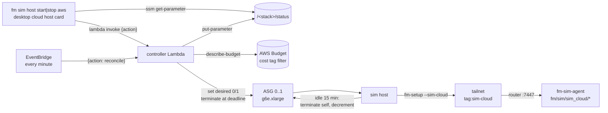

# AWS Sim Host

A CloudFormation stack that runs one fm-sim host on an AWS GPU instance only
while it is needed. The Auto Scaling group holds zero or one `g6e.xlarge`
instance and sits at zero by default. Started, the host provisions itself with
fm-setup's `sim-cloud` role, joins the tailnet, and serves the sim agent's verbs
like any other sim host. It returns to zero on its own after 15 idle minutes,
and a controller terminates it at a hard deadline. A monthly budget gate
refuses a start once spend reaches the cap.

## Why

A cloud GPU is the sim host for anyone without a local GPU, but it bills by the
hour. The controls follow fm-data's annotation stack
(`infra/aws/annotation/`): zero default capacity, a budget read from AWS
Budgets that blocks starts, idle scale-to-zero, and a deadline that does not
trust the instance. This stack keeps only those controls. It has no artifact
bucket or private data plane, because a sim host holds no governed data and
reaches the fleet over the tailnet.

## How



| File | Role |
|---|---|
| `host.yaml` | VPC, security group, roles, launch template, ASG, budget, controller, schedule, status parameter, operator policies |
| `controller.py` | Lambda: `start` behind the budget gate, `stop`, `status`, `reconcile` (deadline and status) |
| `idle_to_zero.py` | Runs on the host every minute: leaves the group after the idle period |
| `fm-sim-idle.service`, `fm-sim-idle.timer` | systemd units the bootstrap installs for the idle check |
| `fm-sim-imds-block.service` | systemd unit that keeps the agent's account off the instance metadata service |
| `deploy.sh` | Operator front door; plans by default |
| `host.params.example` | Keys for the operator's params file |
| `tests/` | Controller and idle logic against fakes, template and bootstrap controls, deploy.sh against a fake `aws` |

### Start

`start` reads the stack's budget from AWS Budgets. Actual monthly spend at or
above `BudgetBlockPercent` of `MonthlyBudgetUsd` refuses the start with
`budget_blocked`. A budget that cannot be read refuses it with
`budget_unavailable`. Otherwise the controller sets desired capacity to 1.
`stop` sets it to 0 and is never gated.

The budget filters on the cost-allocation tag `CostTagKey=CostTagValue`
(default `Project=fm-sim-cloud`). The instance, its volume and its network
interface carry it, and they are where the spend is. The tag must be activated
in Billing: until it is, the budget reads zero spend and every start passes.
`deploy.sh status` warns when the budget reads zero while a host is in the
group. AWS Budgets
refreshes spend a few times a day, so the gate lags real spend by hours. Set
the cap with that headroom.

### Bootstrap

The launch template's user data runs as root, in this order. Any failure,
including a repo fetch running past 5 minutes or the role past 60, makes the host terminate itself
with a decrement, using `curl` against the instance metadata service and the
AWS CLI. If that call fails too, the deadline ends the host.

1. Write `/etc/fm-sim-cloud/host.env` and check the image has `curl`, `git`,
   `aws`, `python3`, `iptables`, `timeout` and `ip`.
2. Fetch fm-sim at `FmSimCommit` and check `HEAD` is that commit.
3. Copy `idle_to_zero.py` to `/usr/local/lib/fm-sim-cloud/` and the three
   units to `/etc/systemd/system/`, all `root:root`, directory 755 and files
   644, and check each owner and mode. Root runs only these copies, never the
   checkout.
4. Create the agent's account, `fm-sim`, the way fm-setup's sim step does, if
   it is missing. Start `fm-sim-imds-block.service` and check its rule:
   `iptables -I OUTPUT -d 169.254.169.254/32 -m owner --uid-owner fm-sim -j DROP`.
   Runs use host networking as that account, so without the rule a run could
   read the host role's credentials. The unit re-applies the rule on every
   boot, before Docker and the agent, and the idle check re-checks it every
   minute. Root keeps the metadata service. The rule is IPv4 only: the VPC has
   no IPv6 range and the IPv6 metadata endpoint is disabled, and the bootstrap
   refuses a host that has a global IPv6 address anyway.
5. Fetch fm-setup at `FmSetupCommit`, check `HEAD`, and run
   `NONINTERACTIVE=1 timeout 60m install.sh --<FmSetupRole>` with the env file
   exported.
6. Start the idle timer.

The user data holds names and pinned identities only. The Tailscale auth key
stays in a SecureString SSM parameter. The host role may read that one
parameter, and nothing else in SSM. It keeps that right for the host's life,
because a re-run of the role reads it again. That is an accepted risk; the
metadata block keeps it from runs.

The bootstrap's output goes to `/var/log/fm-sim-cloud-bootstrap.log` (root,
0600) and also to cloud-init's own output log, which other system accounts may
read. The bootstrap never prints the key or the GHCR token, and the role must
not either.

### Controllers Image

By default the host runs the public `ghcr.io/first-motive/fm-sim` image and
holds no GitHub credential. Set `GhcrTokenParameterName` to run the private
`ghcr.io/first-motive/fm-sim-controllers` image instead, which carries the
private OpenArm description and the `fm_skills` controller.

| Parameter | Default | Meaning |
|---|---|---|
| `GhcrTokenParameterName` | empty | name of a SecureString SSM parameter holding a GitHub token with `read:packages` for `first-motive`; empty runs the public image |
| `GhcrUsername` | empty | GitHub login the token belongs to; required when the token name is set, and the deploy is refused without it |
| `ControllersImageDigest` | empty | `sha256:<hex>` of the controllers image to pull; empty uses fm-setup's own pinned digest |

The token is handled exactly like the Tailscale key. Only its name reaches the
user data. With a name set, the host role may also read that one parameter and
decrypt it through SSM, under the same encryption-context condition; without
one, the role gets neither grant. The host role can read the token for the
host's life. That is the same accepted risk as the auth key. Runs cannot reach
the metadata service: each runs as the agent's account with every capability
dropped, `no-new-privileges`, and no Docker socket, so its packets match the
IMDS block's owner rule even on host networking. The boundary is the agent's
account itself: it is in the docker group, which is root-equivalent, so a
compromised agent could start a root container and read the role. The agent
runs from a pinned commit for that reason. Give the token Packages read only,
since it can pull every private package in `first-motive`.

fm-setup's `sim-cloud` role reads the token, logs in to `ghcr.io`, pulls the
controllers image at the pinned digest, and removes the login, so no
credential stays in Docker's config after provisioning.

Create a fine-grained personal access token on GitHub with resource owner
`first-motive`, the Packages permission set to read only and nothing else,
and an expiry. Store it without echoing it or leaving it in shell history:

```bash
read -rs GHCR_TOKEN   # paste the token; nothing is shown
printf '%s' "$GHCR_TOKEN" | aws ssm put-parameter --profile <profile> --region <region> \
  --name /fm-sim/cloud-host/ghcr-token --type SecureString --overwrite --value file:///dev/stdin
unset GHCR_TOKEN
```

Renew the token before it expires and overwrite the parameter; the next start
reads the new value.

### Idle To Zero

The `fm-sim-idle.timer` runs `idle_to_zero.py check` once a minute. A run is
active while a running container carries the agent's `fm.sim.run_id` label,
which is exactly when the agent's status holds a run. When no run has been seen
for `IdleMinutes`, the host calls `terminate-instance-in-auto-scaling-group`
on itself with `--should-decrement-desired-capacity`, so the group stays at
zero. The clock starts at the first check after provisioning. A Docker that
does not answer counts as idle: a host that cannot run containers cannot serve
a run.

Each check first confirms the metadata block for `fm-sim` is still in
`iptables`. A missing rule is re-inserted and logged. If that fails, the host
terminates itself rather than leave the host role exposed to runs.

The same check terminates the host once it has been up
`MaxLifetimeMinutes`, busy or not, as a second line behind the controller's
deadline.

The check reads Docker, not the agent's Zenoh status, so it works when the
router is unreachable. The host role can only terminate an instance in its own
group with a decrement. It cannot raise capacity.

### Deadline

Every minute, `reconcile` terminates, with a decrement, any instance whose
launch time is `MaxLifetimeMinutes` (default 480) or more in the past, busy or
not. The host's own idle check enforces the same lifetime from its uptime, in
case the schedule does not run. The agent's own two-hour run limit stays in
force on the host.

### Network

The host has a public address and a security group with no ingress rule.
Tailscale connects outbound, so the tailnet ACL on the router's `:7447` is the
only way to reach the agent, as for every sim host. A NAT gateway would bill
around the clock while the host sits at zero, so the stack has none.

Egress is open to `0.0.0.0/0` on every port. The bootstrap and the role
fetch packages, images and code from hosts that change, and Tailscale picks
its relays at run time, so a narrower list would break without notice. That is
an accepted risk: the host has no ingress, and runs cannot reach the metadata
service.

Use a single-use, ephemeral, pre-authorised auth key tagged `tag:sim-cloud`,
with a short expiry. Each start boots a new instance, which consumes the key,
so the operator puts a fresh key in the parameter before each start and the
used one expires on its own.

## Interface

What fm-setup's `sim-cloud` role (step 26) and `fm sim host start|stop aws`
with the desktop card (step 27) build against.

### For The `sim-cloud` Role

The bootstrap runs, as root:

```bash
set -a; . /etc/fm-sim-cloud/host.env; set +a
NONINTERACTIVE=1 timeout 60m /opt/fm/fm-setup/install.sh --sim-cloud
```

| Variable | Meaning |
|---|---|
| `FM_MACHINE_NAME` | machine and tailnet name (default `sim-cloud`; agent key segment `sim_cloud`) |
| `FM_TS_AUTHKEY_SSM_PARAMETER` | name of the SecureString holding the auth key; read it with `aws ssm get-parameter --with-decryption` in `FM_SIM_CLOUD_REGION` |
| `FM_TS_TAG` | `tag:sim-cloud`, the tag the key must grant |
| `FM_ROUTER_ENDPOINT` | `tcp/<router>:7447`, for `/etc/fm-comms.env` |
| `FM_SIM_COMMIT` | fm-sim commit the agent is installed from (the override fm-setup's sim step already reads) |
| `FM_SIM_IMAGE_DIGEST` | `sha256:<hex>` of the fm-sim image (the override fm-setup's sim step already reads) |
| `FM_SETUP_SHA` | fm-setup's own commit check |
| `FM_SIM_CONTROLLERS` | `1` to run the controllers image, `0` for the public image; always written |
| `FM_SIM_CONTROLLERS_IMAGE_DIGEST` | `sha256:<hex>` of the controllers image, or empty for fm-setup's pinned digest |
| `FM_GHCR_TOKEN_SSM_PARAMETER` | name of the SecureString holding the GitHub token, or empty; read it like the auth key |
| `FM_GHCR_USERNAME` | GitHub login for `docker login ghcr.io`, or empty |
| `FM_SIM_CLOUD_REGION`, `FM_SIM_IDLE_MINUTES`, `FM_SIM_MAX_LIFETIME_MINUTES` | used by the idle check |

The role must succeed unattended under `NONINTERACTIVE=1`, on the AMI that
`ImageParameter` names. The default is the AWS Deep Learning Base OSS NVIDIA
Driver GPU AMI for Ubuntu 24.04, which ships the NVIDIA driver, Docker and the
AWS CLI. The `trainer` role targets Ubuntu 26.04, so `sim-cloud` must accept
24.04, or the operator points `ImageParameter` or `ImageIdOverride` at a 26.04
GPU image. The role must finish within 60 minutes and leave Docker running
and `fm-sim-agent` enabled as the `fm-sim` account, so that a run's container
carries the `fm.sim.run_id` label and the metadata block covers it. The
bootstrap creates `fm-sim` first, with the flags fm-setup's sim step uses, so
the step finds it present. Granting `fm-sim` the docker group must not be
declined under `NONINTERACTIVE=1`.

### For The CLI And The App

Stack outputs: `AutoScalingGroupName`, `ControllerFunctionName`,
`ControllerFunctionArn`, `StatusParameterName`, `BudgetName`,
`OperatorPolicyArn`, `ViewerPolicyArn`, `HostName`, `IdleMinutes`,
`MaxLifetimeMinutes`.

Start or stop through the controller only. Calling the ASG directly skips the
budget gate. The controller allows two concurrent invocations, one of them
often the minute reconcile; retry a `TooManyRequestsException`.

```bash
aws lambda invoke --function-name <ControllerFunctionName> \
  --cli-binary-format raw-in-base64-out --payload '{"action":"start"}' out.json
```

The event is exactly `{"action": "start"|"stop"|"status"|"reconcile"}`. The
reply uses the agent's envelope:

```
{"ok": true, "status": Status}
{"ok": false, "error": {"code", "message"}, "status"?: Status}
codes: budget_blocked, budget_unavailable, invalid_request, unknown_action, controller_error
```

Read the status without the power to start, from the String parameter
`/<stack>/status` (`ViewerPolicyArn` grants only that). The controller rewrites
it every minute and after each action:

```
Status = {schema_version: 1, updated_at: iso8601, auto_scaling_group,
          state: "stopped"|"starting"|"running"|"stopping",
          desired_capacity: 0|1,
          instances: [{instance_id, lifecycle_state, launched_at, terminate_after}],
          max_lifetime_minutes, idle_minutes,
          budget: {name, limit_usd, actual_usd, forecast_usd, block_percent,
                   blocked: bool, reason: "under_cap"|"over_cap"|"budget_unavailable"}}
```

`running` means the instance is `InService` in the group. It does not mean the
agent is ready: that is the agent's own `status` on `fm/sim/<host>/status`.
Until the first reconcile, the parameter holds
`{"schema_version":1,"state":"unknown"}`.

## Deploy

An operator deploys. Nothing in CI or this repo calls AWS.

```bash
cp infra/aws/sim/host.params.example ~/fm-sim-host.params   # fill in, outside the repo
export FM_AWS_PROFILE=<profile> FM_AWS_REGION=<region>
export FM_SIM_PARAMS=~/fm-sim-host.params FM_SIM_CODE_BUCKET=<operator bucket>

infra/aws/sim/deploy.sh validate          # local: cfn-lint, tests, shellcheck
infra/aws/sim/deploy.sh plan              # local: prints the upload and deploy commands
infra/aws/sim/deploy.sh deploy --execute  # uploads the controller ZIP and deploys
infra/aws/sim/deploy.sh status            # reads /<stack>/status
infra/aws/sim/deploy.sh start             # or stop; exits 1 when refused
```

Before the first deploy, create the auth key parameter yourself (a single-use,
ephemeral, pre-authorised key tagged `tag:sim-cloud`, with a short expiry, and
a fresh one before each start), enable versioning on the code bucket, and
activate the cost tag in Billing. To run the controllers image, also create the
GitHub token parameter (see [Controllers Image](#controllers-image)). The controller ZIP is content-addressed: its key ends in the ZIP's
SHA-256, and `package` builds the same bytes from the same `controller.py`.

Stop the host before a stack update. An update that changes the group can
re-apply `DesiredCapacity: 0` and terminate a running host. This has not been
checked against a live update.

The default `ImageParameter` follows the latest Deep Learning AMI at each
deploy. For production, set `ImageIdOverride` (see `host.params.example`) to
pin the exact image a host boots.

`deploy --execute` refuses a code bucket without versioning. It uploads the
controller ZIP with an SHA-256 checksum and deploys only when the stored
object's checksum equals the SHA-256 its key names.

## Test

```bash
uv run --no-project --with pytest==8.4.2 --with pyyaml==6.0.3 pytest infra/aws/sim/tests
uvx cfn-lint==1.57.2 infra/aws/sim/host.yaml
shellcheck infra/aws/sim/deploy.sh
```

The tests drive the controller and the idle check against fake AWS, Docker and
metadata clients. They read the controls from `host.yaml` itself, render the
user data with sample values, check the order of its steps, and run `bash -n`
and shellcheck on it. They run `deploy.sh plan` with an `aws` stand-in that
fails the test if called, and `deploy --execute` and `status` against one that
answers.
