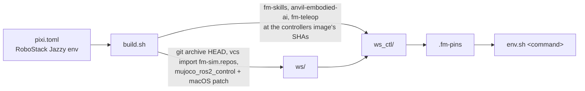

# Native Mac Sim Workspace

Builds and runs the MuJoCo sim stack on macOS itself, in a pixi RoboStack Jazzy
environment, instead of inside the OrbStack container.

## Why

On a Mac every sim backend runs in the fm-docker Linux container, which has no
GPU: MuJoCo renders its cameras on software GL there. A native build renders them
through the Mac's own OpenGL. This directory holds what that build needs and
nothing that runs it for the sim agent.

## How



```bash
pixi run --locked build                                  # ~/.local/share/fm-sim/native
pixi run --locked bash scripts/native/env.sh \
  ros2 launch fm_sim_bringup run.launch.py \
  backend:=mujoco robot:=openarm scenario:=empty controller:=idle use_sim:=true
scripts/native/bench.sh                                  # container vs native (needs Docker + image)
pixi run test-lib                                        # lib.sh tests
pixi run test-bench                                      # bench_verdict.py tests
pixi run --locked test-patch                             # mujoco_ros2_control tests
```

| File | Role |
|------|------|
| `build.sh` | Stages and builds `ws` and `ws_ctl`; `build.sh ws`, `ctl` or `test` runs one stage |
| `lib.sh` | Pinned fetch, manifest pin check and input hash, sourced by `build.sh` |
| `env.sh` | Runs a command in the built workspace with discovery held to this host |
| `bench.sh`, `bench_probe.py`, `bench_verdict.py` | Runs one spec in the container and natively, and prints the go/no-go gate |
| `patches/mujoco-ros2-control-macos.patch` | mujoco_ros2_control 0.1.2 on macOS (below) |
| `shims/mujoco_vendor` | Re-exports conda-forge's libmujoco under the ROS package name |

## Differences From The Image

- **mujoco_ros2_control** is source-built at the image's 0.1.2 commit. RoboStack
  has no build, and its `ros-jazzy-mujoco-vendor` pins an older libmujoco, so the
  shim stands in for it.
- **Cameras** render through a CGL context. The CameraPlugin renders on its own
  thread, and Cocoa allows GLFW windows only on the main thread, so the patch
  replaces the EGL fallback with CGL on Apple. It also uses Mach-O rpaths and
  drops GNU-only linker flags, and adapts upstream's tests to macOS (a `.dylib`
  suffix, two skips; see Known Limits). The patch keeps the Linux code paths
  unchanged.
- **fm_skills_perception** is left out: RoboStack Jazzy builds on OpenCV 5, which
  moved the `calib3d` fisheye API its core links. The image builds only that core
  (no OpenVINO, so no node), and the sim runs ground-truth perception.
- **Uncommitted changes are not built.** `ws` takes this checkout's `HEAD`, so the
  workspace matches a commit.

## Known Limits

- `pixi run --locked test-patch` builds the patched packages with their tests and
  runs them: 40 pass and 2 are skipped on macOS. The skipped two call
  `CameraPlugin::trigger_update()`, which upstream documents as a test hook that
  renders on the calling thread without a live GL context (`camera_plugin.hpp`,
  above its declaration). macOS's libGL crashes on GL calls with no current
  context, so the patch skips them there. Runs render on the plugin's own thread,
  where the context is current.
- First launch after a build is slow: macOS checks the signature of every new dylib
  once.
